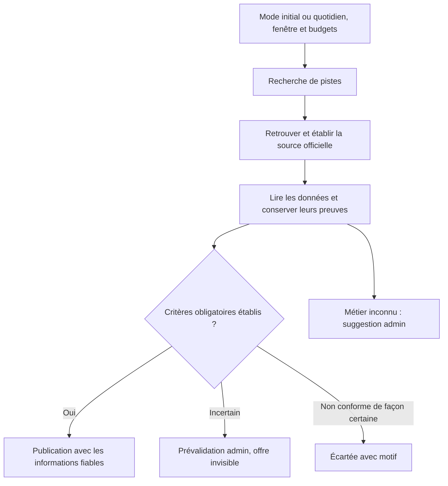

# Exploration — scan saisonnier sans IA

**23 octobre 2026 — proposition à discuter, avant le plan technique détaillé. Aucun scan développé ou activé.**

**Suite de l'exploration :** le [plan technique V1–V5](./plan-technique-scan-v1-v5.md) intègre le dernier objectif : au moins 50 nouvelles annonces distinctes et exploitables pour vérification admin en moins de six heures après installation/lancement. Leur publication n'est pas requise dans ce délai. Le remplissage initial autorise les annonces plus anciennes que 72 heures sans signal de clôture ; tous ses dossiers passent en revue. Les sources employeurs ciblées restent proposées en V1 et la recherche Web par fournisseur en V3. Cette note conserve l'analyse des options étudiées ; son schéma général de publication reste soumis à cette règle du mode initial.

La livraison est progressive : chaque dossier exploitable devient vérifiable pendant que la collecte continue en arrière-plan. Le fil admin s’actualise automatiquement ; ni le seuil de 50 ni la fin du passage ne conditionnent le début de la revue. Le plan technique précise la persistance par dossier et le rafraîchissement de l’écran dès la V1.

Cette note explore une réalisation du [cahier des charges du scan](./cahier-des-charges-scan-saisonnier-v1.md) sans appel à un modèle de langage, avec un objectif de zéro abonnement supplémentaire hors Vercel. Les accès et quotas sont documentés dans la [recherche sur les sources](./recherche-sources-scan-sans-ia.md). Le cahier des charges reste la référence fonctionnelle ; cette exploration ne valide pas encore un fournisseur.

## 1. Proposition

Utiliser TypeScript dans le projet existant : une API de recherche pour découvrir des pistes, des requêtes HTTP pour consulter les sources officielles, des extracteurs de données et des règles explicites pour qualifier les offres. Les cas que ces règles ne savent pas résoudre rejoignent l'admin.

Le compromis porte surtout sur la couverture et le temps humain : un quota gratuit limite les recherches, et un extracteur déterministe ne comprend pas toutes les formulations. « Sans IA » signifie ici sans génération, résumé ou qualification par LLM dans notre application ; cela ne décrit pas les technologies internes du moteur de recherche tiers.

Un MCP n'est pas nécessaire : des appels HTTP depuis le cron suffisent. Il ne rendrait pas gratuite une source payante et ne donnerait pas un accès absent.

Une suspicion de doublon impose un arbitrage admin. Une suggestion de métier ne bloque pas, à elle seule, une offre autrement conforme. Le scan ne modifie pas les offres déjà publiées : leur maintenance conserve son chantier séparé.

## 2. Découverte et budget

**Candidat pour l'extension de recherche Web : Tavily Search Basic**, sans réponse générée ni extraction payante. Le forfait gratuit annonce 1 000 crédits mensuels sans carte ; une recherche Basic utilise un crédit. Verrouiller le mode Basic et désactiver les paramètres automatiques évite de sélectionner involontairement une recherche plus coûteuse. [Crédits Tavily](https://docs.tavily.com/documentation/api-credits), [paramètres Search](https://docs.tavily.com/documentation/api-reference/endpoint/search).

Une hypothèse prudente serait **20 appels de recherche par jour au total**, recherches initiales et remontées vers l'employeur comprises : au plus 620 crédits sur 31 jours. Ce nombre n'est ni un objectif de production ni un nombre d'annonces. La réserve mensuelle ne serait utilisée que dans un plafond explicitement configuré, sans achat automatique. Les compteurs doivent couvrir tous les consommateurs de la même clé.

Les requêtes combineraient secteurs, saisons, zones et termes de recrutement, avec rotation lorsque le budget ne permet pas toutes les combinaisons chaque jour. La répartition devra être mesurée : trop de recherches sur des agrégateurs peut consommer le quota pour retrouver les sources officielles.

Les dates du moteur orientent la recherche mais ne prouvent pas la date originale de l'annonce. Préserver une stratégie pour les résultats non datés, admis sous conditions par le cahier des charges. À la source, distinguer publication employeur, première découverte et publication sur notre plateforme ; conserver la précision réelle de chacune.

France Travail indique actuellement un accès restreint et une API temporairement non exposée. Les documentations consultées n'établissent pas d'accès libre à une collecte générale d'Indeed ou de LinkedIn. Ces connecteurs ne peuvent donc pas être des prérequis de lancement. La priorité souhaitée aux job-boards se traduira d'abord par des pistes indexées accessibles, puis par les accès effectivement accordés. [Fiche France Travail](https://www.data.gouv.fr/dataservices/api-offres-demploi), [détail des autres accès](./recherche-sources-scan-sans-ia.md).

Cela permet de viser zéro frais de fournisseur supplémentaire dans les quotas actuels, sans le garantir à tout volume. L'exécution, le stockage et le trafic utilisent les ressources existantes et leurs conditions de facturation ; les bibliothèques gratuites ne rendent pas l'infrastructure illimitée.

## 3. Lecture des offres et textes libres

Ordre proposé :

1. Lire les données `JobPosting` intégrées à la page, lorsqu'elles existent.
2. Utiliser l'API publique du portail employeur pour une offre déjà identifiée, lorsque cet accès est documenté et approprié.
3. Lire le HTML avec `fetch` et Cheerio ; ajouter des règles spécifiques aux formats réellement fréquents dans notre échantillon.
4. Conserver une piste exploitable pour l'admin lorsque la page ou son contenu ne peut pas être interprété de façon sûre.

Cheerio analyse le HTML mais n'exécute pas le JavaScript de la page. Un site qui construit tout son contenu dans le navigateur peut nécessiter un autre accès. Un navigateur automatisé serait une extension ciblée à évaluer, pas un prérequis de cette V1. [Documentation Cheerio](https://cheerio.js.org/docs/intro/).

**Une annonce rédigée librement peut rejoindre directement la prévalidation admin.** Elle peut aussi être partiellement préremplie si certaines informations sont explicites. Il ne faut pas considérer toutes les annonces contenant du texte libre comme illisibles, ni considérer un fichier JSON comme une annonce entièrement qualifiée.

| Information rencontrée | Décision proposée |
|---|---|
| Mention explicite d'un contrat saisonnier attachée au poste | Preuve possible ; vérifier le contexte et les contradictions |
| Simple CDD, temps plein ou dates pendant l'été | Ne démontre pas un contrat saisonnier |
| Période complète ou durée explicitement attachée au poste | Extraire la valeur et son passage source |
| `validThrough` | Échéance de l'annonce, jamais date de fin du contrat par défaut |
| Email ou téléphone dans une rubrique de candidature | Canal possible ; vérifier qu'il sert bien à candidater |
| Téléphone de réception en pied de page, ou `applicationContact` seul | Ne suffit pas à établir un canal de candidature |
| Formulaire officiel seul | Admissible avec le badge « Candidature externe » |
| Montant salarial sans unité ou qualification net/brut claire | Conserver la preuve ; ne pas inventer les précisions absentes |
| Logement « possible » | Ne satisfait pas un filtre exigeant un logement confirmé |

Les champs structurés ont des sens différents : `applicationContact` peut désigner un contact d'information et `directApply` un parcours en ligne. [Schéma JobPosting](https://schema.org/JobPosting). La date d'expiration concerne l'annonce. [Documentation Google JobPosting](https://developers.google.com/search/docs/appearance/structured-data/job-posting).

Chaque valeur retenue doit pouvoir être reliée à une URL, une date de consultation et un champ structuré ou un passage de texte. Les règles doivent tenir compte des négations et de l'association au poste : une promesse générale d'un groupe hôtelier ne prouve pas un avantage pour toutes ses offres.

Le résumé public peut être composé à partir des faits établis et de passages pertinents, selon les conditions de réutilisation. Une reformulation libre et riche n'est pas garantie sans intervention humaine. Les données facultatives absentes restent « non précisé » ; leur absence ne crée pas une obligation de revue. Une contradiction facultative produit « à confirmer » et une alerte non bloquante.

Le téléchargement doit être borné en durée et en taille, respecter les accès autorisés et contrôler les destinations publiques, y compris après redirection. Le HTML collecté ne doit pas être rendu comme du contenu applicatif de confiance.

## 4. File admin et suggestions

La file présente la source, le texte utile, les champs préremplis et **la raison précise de l'intervention** : provenance incertaine, période manquante, contrat ambigu, candidature non établie ou doublon potentiel. L'admin complète ou corrige, vérifie les minimums puis approuve la publication ou rejette la piste.

Pour un métier ou une famille absente du référentiel : créer une suggestion contenant le libellé d'origine, le contexte, la source et les offres concernées. L'admin peut rattacher à un métier existant, créer la référence ou rejeter la suggestion. Les décisions déjà prises doivent être réutilisées ; la même suggestion ne doit pas revenir chaque nuit. Aucune création automatique et aucun rattachement incertain utilisé pour les filtres.

Il faut distinguer les offres bloquées avant publication, les alertes facultatives sur des offres publiées et les suggestions de référentiel. Approuver une suggestion de métier ne vaut pas approbation humaine de l'annonce. Les incidents techniques récurrents doivent aussi être regroupés, pour éviter une nouvelle tâche admin identique à chaque passage.

## 5. Adaptations constatées dans le projet

La pile actuelle — TypeScript, Next.js, Drizzle et PostgreSQL — convient. L'intégration exige toutefois plus qu'un branchement du cron sur l'import existant.

| Constat vérifié | Conséquence pour le futur plan |
|---|---|
| [Ingestion actuelle](../src/server/offers/ingest.ts) : `seasonalContractConfirmed` fixé à `true` | Exiger une preuve explicite avant publication automatique ; une saison renseignée n'est pas une preuve de contrat |
| Même import : mise à jour par URL, statut forcé à `published`, dates de retrait effacées | Créer un parcours de découverte qui préserve les offres existantes, les corrections humaines et les retraits |
| [Table des offres](../src/lib/db/schema/offers.ts) : entreprise, lieu, saison et contraintes de période/candidature imposés | Stocker les pistes incomplètes séparément ; le statut `pending_review` ne suffit pas à contourner ces contraintes |
| Même table : unicité des offres collectées par `sourceUrl` | Revoir l'identification pour plusieurs postes sur une page et les URL réutilisées ; aucune fusion entre annonces distinctes sans admin |
| Même table : une localisation et une date de publication plateforme | Prévoir les lieux multiples et les dates de source/découverte distinctes |
| [Vérifications admin](../src/app/(app)/admin/verifications/page.tsx) centrées sur les rattachements entreprise | Ajouter le traitement des pistes et suggestions ; réutiliser les formulaires pertinents |
| [Référentiel métiers](../src/lib/db/schema/reference.ts) : famille sous forme de texte | S'appuyer sur ce modèle existant pour les suggestions, sans imposer une refonte du référentiel |
| [Exécution des tâches](../src/server/jobs/run.ts) : dernier résumé enregistré après succès | Ajouter progression durable, erreurs, historique et protection contre deux passages simultanés |

Une séparation simple suffit : accès aux sources, extraction de faits, décision métier, puis enregistrement/publication. Les règles métier reçoivent des données et produisent une décision motivée ; elles ne déclenchent pas elles-mêmes des recherches Web. Cela permet de remplacer un moteur ou d'ajouter un format de page sans changer les critères de publication.

## 6. Exécution quotidienne

Prévoir une tâche dédiée, avec son interrupteur et ses compteurs. Conserver pour chaque passage quotidien sa fenêtre fixe de 72 heures, son budget et son avancement. Le remplissage initial élargi constitue une campagne distincte. Réserver les appels avant exécution, limiter le parallélisme par site et arrêter proprement avant la limite de durée ou de crédits.

Vercel ne relance pas automatiquement un cron en échec ; des déclenchements peuvent aussi se chevaucher ou être livrés plusieurs fois. Il faut donc un verrou en base, des opérations répétables sans duplication et une progression enregistrée pendant le traitement. [Gestion des crons Vercel](https://vercel.com/docs/cron-jobs/manage-cron-jobs).

Un traitement interrompu conserve ses pistes déjà découvertes pour une reprise contrôlée. Le prochain passage de découverte utilise sa propre fenêtre de 72 heures, sans recherche historique élargie. Une publication différée doit toujours vérifier que les critères minimums et la pertinence temporelle restent établis.

Le [cron actuel](../vercel.json) fonctionne à 3 h UTC, soit 4 h ou 5 h à Paris : ne pas recopier son horaire en prétendant respecter la cible « vers 3 h Europe/Paris ». Le choix précis dépendra du plan Vercel et de la durée mesurée. Les limites du compte ne sont pas connues ici. [Limites des fonctions](https://vercel.com/docs/functions/limitations).

L'option initialement envisagée était un traitement borné avec état durable dans PostgreSQL. Pour le nouvel objectif à six heures, le plan propose désormais Vercel Workflow dès la V1 afin d'assurer la continuation automatique entre étapes. Sa compatibilité et les limites du compte doivent être vérifiées ; il utilise les ressources facturées de Vercel. [Workflows Vercel](https://vercel.com/docs/workflows).

## 7. Ce qui reste à mesurer avant de figer le plan

Un pilote sur 20 à 30 pages représentatives devrait relever : nombre de pistes distinctes, sources officielles retrouvées, pages lisibles, critères obligatoires établis automatiquement, temps de revue admin et crédits consommés. Inclure texte libre, formulaire seul, métier inconnu, contradiction de dates, page multi-postes et annonce déjà connue.

Les connecteurs spécifiques doivent être choisis d'après cet échantillon, pas d'après la seule existence d'une API. Greenhouse et Lever illustrent des accès publics documentés, sans preuve à ce stade qu'ils couvrent une part importante de nos établissements cibles.

Cette exploration repose sur la lecture du code et des documentations. Deux pages employeur consultées illustrent les difficultés : une [offre présentée sur SmartRecruiters](https://jobs.smartrecruiters.com/AccorHotel/744000141974509-serveur-petit-dejeuner-h-f-cdd-saisonnier-30h) donne plusieurs fins possibles dans son texte ; une [page métiers Belambra](https://recrute.belambra.fr/pages/nos-metiers) décrit plusieurs types de contrats et avantages généraux. Ces exemples ne constituent ni des offres validées pour notre fenêtre ni une mesure de couverture.

Un essai local de récupération HTTP a échoué sur une résolution DNS (`ENOTFOUND`) dans l'environnement de travail. Cela ne démontre pas un blocage du site depuis Vercel. Aucun parcours complet recherche → extraction → publication n'a été exécuté, aucun compte fournisseur créé et aucun rendement automatique mesuré.

**Orientation après l'étude complémentaire :** poursuivre sans LLM avec les sources employeurs ciblées, extraction explicable et revue admin. Le [plan V1–V5](./plan-technique-scan-v1-v5.md) fixe désormais la cible initiale et la progression proposée. La mise en avant payante et la maintenance restent des chantiers séparés ; le parcours récurrent des catalogues employeurs reste prévu en V2 du scan.

## 8. Compléments techniques issus de l'étude fournie

- **Teamtailor** documente officiellement son flux `jobs.rss`, les champs et la pagination. Cela ne prouve pas encore le fonctionnement du flux d'un employeur donné depuis notre application. [Guide RSS officiel](https://support.teamtailor.com/en/articles/11171756-rss-feed-how-to-guide).
- **Recruitee** annonce l'obligation d'un jeton pour son API carrière à partir du **10 février 2027**. Le flux XML est explicitement exclu de ce mécanisme et son adresse est documentée. Évaluer ce flux ou un accès accordé, sans supposer que le JSON restera accessible sans clé. [Authentification](https://docs.recruitee.com/reference/authentication-1), [export XML](https://support.recruitee.com/en/articles/8206006-faq-data-export).
- **SmartRecruiters** documente une liste par entreprise, ses filtres et le détail des annonces. Cela justifie un essai ciblé, pas une promesse d'accès universel. [API des annonces](https://developers.smartrecruiters.com/reference/v1listpostings).
- **Let's Employ** présente un format ouvert, un export quotidien et une API. Aucune couverture suffisante de nos saisonniers français n'a été mesurée. [Présentation officielle](https://www.letsemploy.org/fr/).

L'étude réintroduit un enrichissement IA et un traitement général des doublons/expirations. Le plan conserve notre choix sans LLM, l'arbitrage humain des doublons et le chantier de maintenance distinct. Les restrictions d'EasyJobs, Arbeitnow et Jobicy sont détaillées dans la note sur les sources.
