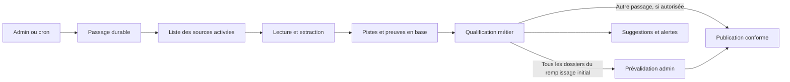

# Plan technique du scan saisonnier — V1 à V5

**23 octobre 2026 — proposition de réalisation.** **V1 livrée le 29 octobre 2026** (tag `scan-v1.0.0`) : 128 dossiers livrés en production au remplissage initial du 28/10, seuil de 50 atteint à T+2 min 12 s ; scan quotidien actif depuis le 29/10 ([compte rendu de recette](./scan/recette-v1.md)). La gestion des sources dans l'admin, prévue en V2, est livrée par anticipation ([plan scan V2-01](./plans/scan-v2/01-gestion-des-sources.md), 28/10/2026).

Références : [cahier des charges du scan](./cahier-des-charges-scan-saisonnier-v1.md), [exploration technique](./exploration-scan-sans-ia-v1.md), [recherche des sources](./recherche-sources-scan-sans-ia.md), [plans d'implémentation de la V1](./plans/scan-v1/README.md).

## 1. Résultat demandé et décisions acquises

La **V1 du scan doit fournir au moins 50 nouvelles annonces distinctes à vérifier par l'admin, en moins de six heures après installation et lancement initial**, avec zéro frais de services supplémentaires hors Vercel. Le délai porte sur la mise à disposition des dossiers dans la file admin : ni leur vérification humaine ni leur publication ne sont requises dans ces six heures. Le développement n'en fait pas partie. Ces versions concernent le scan, pas l'ensemble de l'application.

**Livraison au fil de l'eau dès la V1 :** le scan s'exécute en arrière-plan et chaque dossier exploitable devient accessible à la revue dès son enregistrement. L'admin peut le corriger, le valider ou le rejeter pendant que la collecte continue. Ni la fin du passage, ni le seuil de 50, ni l'échéance de six heures ne conditionnent l'ouverture de la revue. Cette règle vaut aussi pour les dossiers à vérifier des passages suivants.

Le premier remplissage peut reprendre des offres actives publiées depuis plus de 72 heures, avec leur vraie date. Les passages quotidiens conservent ensuite une fenêtre de 72 heures. Une campagne initiale interrompue reprend son avancement ; un redéploiement ne crée pas un nouvel amorçage.

La réalisation proposée fonctionne sans LLM : API ou flux disponibles, téléchargement de pages, extraction par code, règles explicites et validation admin. Les annonces en texte libre peuvent être préremplies puis soumises à l'admin. Le remplissage initial alimente la file de vérification, y compris pour les dossiers déjà complets ; aucune publication automatique n'est nécessaire à son objectif. Les règles de publication des autres passages restent distinctes de ce mode initial.

L'objectif de 50 est un **critère de recette à démontrer**, pas un volume déjà acquis : il faut des dossiers pertinents, consultables et exploitables pour la revue, même si des informations nécessaires à la publication restent à établir. Ni un compteur de résultats ni un quota API ne prouvent ce résultat.

## 2. Les cinq niveaux

| Niveau | Résultat concret | Apport technique principal | Condition de réussite |
|---|---|---|---|
| **V1 — Collecter pour vérification** | Fournir au moins 50 annonces distinctes à vérifier avant T+6 h, puis lancer le scan quotidien | Sources ciblées, extracteurs, préqualification et file admin avec preuves et champs manquants | 50 dossiers exploitables livrés avant T+6 h, sans doublons connus ni frais de fournisseur supplémentaires ; publication mesurée séparément |
| **V2 — Couvrir les employeurs connus** | Retrouver les offres admissibles des entreprises déjà identifiées | Scan de catalogue par entreprise distinct, gestion du registre, pagination et reprise par source | Parcours complet des sources activées, omissions et erreurs mesurées |
| **V3 — Découvrir de nouveaux employeurs** | Élargir la couverture au-delà du registre initial | Recherche Web plafonnée, API autorisées, remontée des agrégateurs vers l'employeur | Nouvelles sources officielles et nouvelles offres obtenues pour un budget mesuré |
| **V4 — Réduire le travail manuel** | Lire davantage de formats et traiter plus vite les volumes utiles | Connecteurs mutualisés, règles d'extraction enrichies, traitement parallèle borné, outils de revue améliorés | Moins de minutes admin par offre, sans dégradation des critères de publication |
| **V5 — Piloter une recherche nationale** | Orienter automatiquement les efforts vers les secteurs et territoires insuffisamment couverts | Planificateur par rendement, carte de couverture, priorisation des sources, observabilité et quotas globaux | Couverture et fraîcheur progressent à coût contrôlé, décisions et preuves auditables |

La V5 reste compatible avec une architecture sans LLM. Une éventuelle brique IA serait un choix ultérieur, facultatif et budgété ; elle ne remplace pas les décisions réservées à l'admin. Aucun niveau ne promet une couverture exhaustive d'Internet.

## 3. Règles conservées dès la V1

- France, annonces en français, tourisme/hôtellerie de loisirs et fonctions support du secteur, contrat explicitement saisonnier.
- Entreprise identifiable, source officielle établie, localisation précise, période ou durée et canal de candidature utilisable.
- Email/téléphone de candidature prioritaires ; formulaire officiel seul accepté avec « Candidature externe » sur carte et fiche.
- Information obligatoire douteuse : offre invisible jusqu'à vérification. Facultatif absent : « non précisé ». Facultatif contradictoire : « à confirmer », alerte non bloquante et exclusion des filtres exigeant une valeur établie.
- Métier ou famille inconnus : suggestion admin persistante, sans création automatique ; ce seul manque ne bloque pas la publication.
- Doublon potentiel : arbitrage humain. Redécouverte du même dossier : pas de nouvelle fiche. Aucune fusion automatique entre URL ni avec une annonce déposée.
- Aucune mise à jour silencieuse d'une offre publiée, aucun écrasement des corrections humaines et aucune remise en ligne automatique d'un retrait.
- Provenance, dates et validation humaine conservées. Une modification ou un rattachement de métier ne vaut pas validation humaine de publication.
- Plusieurs postes sur une page sont séparés uniquement si leurs associations sont explicites ; un même poste à plusieurs lieux reste une fiche à plusieurs localisations.

Ces critères régissent la publication ; ils ne doivent pas empêcher l'enregistrement d'un dossier incomplet dans la file admin. Pendant le remplissage initial, un dossier complet passe aussi par la vérification humaine. La maintenance des annonces publiées, les retraits à la source et la mise en avant payante conservent leurs crons/plans séparés. Le contrôle préalable à une nouvelle publication reste nécessaire.

## 4. V1 : sources et stratégie pour obtenir les 50 dossiers à vérifier

### Un ensemble préparé de sources employeurs

Commencer avec quelques portails réellement utilisés par les employeurs cibles. Leur configuration et les extracteurs sont livrés avec la V1 : le fondateur n'a pas à saisir 50 URL d'annonces. Pas de dépendance initiale à une API de recherche payante, à une demande d'accès France Travail ou à un annuaire exhaustif.

| Source candidate | Observation du 23 octobre | Travail restant avant activation |
|---|---|---|
| **VVF / Factorial** | [Portail officiel](https://vvfrecrute.factorial.fr/) : 27 liens de fiches hors candidature spontanée dans le relevé. Une [offre serveur](https://vvfrecrute.factorial.fr/job_posting/serveur-h-f-326962) précise contrat saisonnier et dates du 1er février au 23 mars 2027. | Tester la récupération depuis Vercel, extraire les fiches et résoudre les lieux précisément ; vérifier les formulaires et conditions de reprise |
| **Belambra / Teamtailor** | [Liste officielle](https://recrute.belambra.fr/jobs) : 94 offres affichées, tous contrats confondus. Certaines fiches saisonnières ne donnent pas de durée dans le texte consulté. | Vérifier pagination/flux et extraction ; isoler les offres dont les minimums sont établis |
| **Pierre & Vacances / PVCP** | [Page Talents officielle](https://www.groupepvcp.com/talents/) et fiches de recrutement accessibles ; liste dynamique sans inventaire fiable lors du relevé | Confirmer un accès de liste exploitable ; source de réserve tant que cet accès n'est pas établi |
| **Sandaya / WeRecruit** | [Page employeur officielle](https://www.sandaya.fr/footer/sandaya/offres-d-emploi) reliée au portail de recrutement ; compteur récent non confirmé | Tester l'accès public à la liste et au détail ; ne pas compter les anciens résultats indexés comme un stock disponible |

Les 94 offres Belambra et les 27 liens VVF ne représentent pas encore 121 dossiers exploitables : il faut vérifier leur pertinence et consulter leur contenu. L'accès au formulaire et les minimums de publication pourront rester à vérifier dans le dossier. Les accès de collecte et les conditions de reprise restent à établir ; aucun de ces connecteurs n'a été exécuté depuis l'application.

**Choix d'exécution :** développer d'abord les sources lisibles avec le plus d'annonces pertinentes et exploitables pour une revue dans un petit échantillon. Ajouter une source de réserve si leur réservoir ne permet pas d'atteindre 50 dossiers. SmartRecruiters est également candidat si des employeurs pertinents sont identifiés ; Greenhouse, Lever ou Ashby ne sont pas prioritaires par leur seule disponibilité technique.

**Arbitrage du fondateur du 23/10/2026 pendant le plan 01 :** France Travail est ajouté comme découverte prioritaire sur sa recherche filtrée fournie, selon SH17 des plans du scan. L'accès vérifié utilise la liste HTML et le JSON public du composant de détail sur le même hôte ; il ne dépend pas de l'API partenaire restreinte. Cette exception ciblée au périmètre initial ne transforme pas France Travail en source officielle employeur pour la publication. Voir le [dossier de sources et ses mesures](scan/sources-v1.md).

Un dossier découvert sur France Travail ou un autre job-board peut compter dans l'objectif admin alors que la source officielle employeur reste à retrouver. Il reste invisible aux candidats. Ce changement de compteur ne valide pas un accès automatisé à France Travail et ne rend pas ce site obligatoire ou exclusif pour la V1.

### Préparation avant installation

1. Examiner quelques fiches par source : pertinence pour les saisonniers du secteur, contenu disponible et informations déjà extraites ou restant à vérifier.
2. Confirmer que notre code accède aux listes et aux fiches en preview Vercel ; la lecture par un moteur de recherche n'est pas ce test.
3. Constituer les règles spécifiques et leurs exemples de référence. Le contenu officiel apporte les preuves ; aucune date ou coordonnée n'est inventée.
4. Mesurer les dossiers exploitables, le délai de livraison en file et, séparément, le temps de revue. Tant que le réservoir ne soutient pas la cible, ajouter des sources plutôt que déclarer la V1 prête pour l'objectif de 50.

### Les six premières heures

| Échéance depuis le lancement | Fonctionnement attendu |
|---|---|
| **T0** | Déclenchement immédiat du remplissage initial, création du passage et de son échéance T+6 h ; aucun besoin d'attendre la nuit |
| **Dès le premier dossier exploitable** | Enregistrement et accès à la revue pendant que le passage est encore en cours ; aucune attente volontaire pour constituer un lot de 50 |
| **T0 à T+1 h** | Lecture bornée des sources et livraison progressive des premiers dossiers préremplis ; aucune attente de cette échéance pour les afficher |
| **T+1 à T+3 h** | Traitement des sources de réserve ; compteur des dossiers livrés et du nombre restant pour atteindre 50 |
| **T+3 à T+5 h** | Derniers lots utiles et reprises d'échecs transitoires ; signalement si les pistes exploitables ne permettent pas d'atteindre la cible |
| **Avant T+6 h** | Seuil d'au moins 50 dossiers distincts exploitables atteint et horodaté |
| **T+6 h** | Bilan : dossiers livrés, dossiers encore à vérifier, doublons/écarts, échecs et consommation ; publications affichées séparément |

Ce découpage est une cible opérationnelle à tester, pas une estimation déjà mesurée. La livraison des dossiers ne dépend pas de la présence de l'admin. Il peut commencer la revue dès leur arrivée ou après les six heures ; son temps de travail n'entre pas dans la mesure du délai de collecte.

Une annonce compte lorsqu'un nouveau dossier distinct, relié au passage initial, est réellement accessible à la revue avec : un intitulé, une URL précise de découverte, la date de collecte, du texte utile ou des données extraites, des indices documentés de pertinence pour le périmètre et la liste des points à vérifier. L'employeur, le lieu et les autres champs sont préremplis lorsqu'ils sont disponibles ; leurs incertitudes sont explicites. Une période, un canal de candidature ou la source officielle manquants n'empêchent pas ce comptage.

Une simple URL sans contenu exploitable, une annonce manifestement hors périmètre ou explicitement close, une redécouverte, un doublon connu, un dossier déjà présent ou des données de démonstration ne comptent pas. Une suggestion de métier, une alerte ou un signalement de doublon ne constitue pas une annonce supplémentaire. L'absence de preuve de clôture ne vaut pas validation de l'activité de l'offre : ce point reste visible à la revue.

Le compteur mesure le cumul des dossiers admissibles livrés, avec `readyForReviewAt` et l'instant `targetReachedAt` où le seuil est atteint. Il reste distinct du stock actuellement en attente et du nombre publié : une revue commencée tôt ne remet pas le compteur à zéro. La recette exige `targetReachedAt < startedAt + 6 heures` et contrôle les exclusions ci-dessus ; elle n'exige pas 50 validations humaines.

Pour rendre le parcours simple, `/admin/scan` propose « Lancer le premier remplissage », le compteur « Dossiers livrés pour vérification : … / 50 » et la file « À vérifier ». La revue affiche les preuves et les manques, préremplit le formulaire existant et permet de passer au dossier suivant. L'admin complète, valide ou rejette ; la publication reste soumise aux critères minimums. Si moins de 50 dossiers exploitables sont livrés, le bilan le dit.

Le fil et les compteurs se rafraîchissent automatiquement pendant le passage. Une nouvelle arrivée ne remplace pas le dossier ouvert, ne déplace pas la sélection et ne réinitialise pas un formulaire en cours de saisie. Une file momentanément vide indique « Recherche en cours » tant que le scan travaille ; la fin du passage est présentée séparément. Fermer puis rouvrir l'écran retrouve les dossiers persistés et leurs décisions.

## 5. Architecture technique de la V1

### Pile et exécution

Conserver TypeScript, Next.js, PostgreSQL/Neon et Drizzle. Utiliser `fetch`, un parseur HTML tel que Cheerio et un parseur XML pour les flux retenus, avec versions compatibles vérifiées lors de l'implémentation. Aucun MCP ni clé LLM requis.

**Proposition : Vercel Cron déclenche un Vercel Workflow**, également déclenchable par l'admin. Les étapes durables lisent les sources et traitent des lots bornés. Cela évite de faire dépendre les six heures d'une seule requête HTTP. Workflow documente les reprises après interruption et les étapes réessayables ; son exécution utilise les ressources Vercel, dont la facturation reste à surveiller. [Documentation Vercel](https://vercel.com/docs/workflows).

L'intégration nécessite le SDK `workflow`, la configuration Next correspondante et une exclusion des routes internes Workflow dans le proxy. Fixer une version compatible et vérifier le fonctionnement en preview. Ne pas supposer que tous les modules serveur peuvent être appelés directement depuis le corps déterministe du workflow : réseau et base appartiennent aux étapes. [Guide officiel Next.js](https://workflow-sdk.dev/docs/getting-started/next).

La disponibilité et les limites sur le compte Vercel doivent être vérifiées pendant l'installation. Si cette solution ne convient pas, le repli est un traitement borné avec progression en base et reprise admin ; il doit repasser la recette des six heures avant d'être considéré équivalent. Ne pas remplacer la reprise durable par une promesse non attendue après la réponse HTTP.

### Collecte et revue indépendantes

1. Le déclenchement répond avec l'identifiant du passage après prise en charge durable, sans attendre sa collecte complète. Le navigateur ne maintient pas l'exécution en vie : fermer l'onglet n'arrête pas le scan.
2. Après extraction et contrôle d'admission d'un dossier, une transaction courte enregistre ses preuves, son état de revue et `readyForReviewAt`. La mise à disposition se fait dossier par dossier, sans transaction englobant une source ou un lot entier. La lecture et les enrichissements des autres pistes continuent sans attendre une décision admin.
3. L'écran admin lit les dossiers et compteurs persistés par une route réservée aux admins. Pour la V1, retenir un rafraîchissement automatique toutes les **5 secondes** tant que l'écran est visible et qu'un passage est actif, ainsi qu'au retour sur l'écran. Une arrivée apparaît au rafraîchissement suivant, sans rechargement complet ni service temps réel payant. Ces lectures doivent retourner un état frais, sans cache périmé, avec pagination et réponses bornées. En cas d'échec, conserver le fil et la saisie, signaler l'interruption de l'actualisation puis réessayer avec temporisation.
4. La revue et le scan utilisent des écritures contrôlées par statut/version. Une reprise ou un enrichissement tardif ne remet pas un dossier traité en attente, ne modifie pas une décision humaine et n'écrase pas une correction. Une divergence utile devient une observation séparée. Les décisions admin restent possibles pendant un passage, sans verrou global de collecte.
5. Les dossiers déjà livrés restent consultables et traitables si une autre source échoue ou si le passage s'arrête. La revue ne dépend pas de la clôture du workflow. Le seuil de 50 mesure les livraisons cumulées, indépendamment des dossiers déjà traités.

Mesurer séparément le délai entre lancement et premier dossier prêt, entre enregistrement et apparition dans le fil, et jusqu'au cinquantième dossier. Aucun délai de première extraction n'est encore démontré ; l'exigence est de ne pas différer artificiellement sa livraison. Le bilan final complète la progression visible pendant tout le passage.

### Modules à créer

| Emplacement proposé | Responsabilité |
|---|---|
| `src/domain/scan/` | Qualification pure, fenêtre temporelle, raisons de blocage, identité d'un recrutement, suggestions et règles du compteur |
| `src/server/scan/sources/` | Adaptateurs par format : lister les pistes, consulter une offre, extraire les faits avec leurs preuves |
| `src/server/scan/` | Registre, passages, persistance, revue, budgets, publication transactionnelle et permissions |
| `src/workflows/scan.ts` | Orchestration des étapes, lots, reprises et clôture du passage |
| `src/app/api/cron/scan/route.ts` | Vérification du secret, état activé et déclenchement quotidien unique |
| `src/app/(app)/admin/scan/` | Lancement, avancement, revue et suggestions, protégés par le rôle admin |

L'adaptateur renvoie des observations, jamais une décision de publication. Distinguer l'admission d'un dossier exploitable dans la file et sa conformité pour publication. La qualification reçoit les observations et les référentiels puis renvoie une décision motivée ; le mode initial impose la revue même si le dossier est complet. Le service de publication vérifie de nouveau les minimums et l'état du dossier dans la transaction.

### Données à ajouter

| Données | Contenu minimum |
|---|---|
| **`scan_sources`** | URL officielle, preuve de rattachement employeur, type d'adaptateur, configuration publique, conditions de reprise, activation et limites. Un portail de groupe peut contenir plusieurs employeurs : ne pas leur attribuer automatiquement la même identité juridique. |
| **`scan_runs`** | Mode `bootstrap` ou `daily`, début, échéance, `targetReachedAt`, fenêtre quotidienne, état, identifiant d'orchestration, progression par source, erreurs et compteurs séparés de livraison/revue/publication |
| **`scan_candidates`** | Identité interne stable, identifiant externe s'il existe, URL de découverte et officielle si trouvée, observations/preuves, données proposées, première découverte, `readyForReviewAt`, précision de date source, statut, motif et éventuel `offerId` |
| **`scan_reviews`** | Prévalidation, alerte facultative, suggestion métier/famille ou doublon ; décision datée, auteur, références des dossiers/offres et clé de regroupement pour éviter les répétitions |
| **Offres / provenance** | Date source et sa précision, première découverte, référence au dossier, validation humaine datée et auteur ; état de certitude des champs facultatifs exposés aux filtres |
| **Localisations** | Relation des lieux d'une offre, reprise des lieux existants et adaptation cohérente de l'affichage, des filtres et de leur oracle de test |

Les observations contiennent seulement ce qui est nécessaire à la preuve et à la revue, avec version d'extracteur et horodatage ; borner leur volume et définir leur conservation. L'état d'orchestration ne remplace pas l'historique métier en base.

L'unicité d'un dossier repose sur le recrutement identifié, pas sur la seule URL. Un identifiant ATS déjà connu permet de retrouver un dossier, mais une réutilisation pour une autre période doit être détectée. Sans identité suffisamment sûre, créer un rapprochement à examiner. Les empreintes de contenu aident à détecter des changements ; elles n'autorisent pas une fusion entre annonces.

### Adaptations indispensables de l'existant

1. **Ingestion** : [ingest.ts](../src/server/offers/ingest.ts) force actuellement `seasonalContractConfirmed: true` et republie sur conflit d'URL. Remplacer cette voie pour le scan par une création contrôlée ; conserver le parcours d'édition admin et protéger les statuts existants.
2. **Schéma des offres** : [offers.ts](../src/lib/db/schema/offers.ts) impose entreprise, lieu, période et candidature même avec `pending_review`. Les pistes incomplètes restent dans leur table dédiée. Remplacer l'unicité de source URL avec les contrôles applicatifs correspondants, sans migration qui fusionne ou supprime des offres.
3. **Affichage** : distinguer les labels « Sourcée sur internet » et « Vérifiée par un humain », et le badge indépendant « Candidature externe ». Utiliser les droits et restrictions de candidature actuels ; ne pas exposer des coordonnées par une nouvelle réponse publique.
4. **Référentiel** : réutiliser les mutations admin de métiers et familles. Enregistrer les décisions et alias validés ; ne pas reclasser automatiquement des intitulés ambigus.
5. **Tâches** : compléter le dernier résumé de [run.ts](../src/server/jobs/run.ts) par un historique des passages et leur progression. Le scan démarre désactivé avant configuration, même si les tâches existantes sont activées par défaut.

### Exécution, reprises et limites

- Un identifiant unique par campagne initiale et par jour de scan ; un verrou ou bail en base protège le déclenchement simultané. Une livraison répétée ne crée ni seconde campagne ni double publication.
- Réservation atomique des dossiers avant traitement ; publication et liaison dossier/offre dans la même transaction. Des étapes réessayées doivent pouvoir constater qu'une publication a déjà réussi.
- Limites configurables par source, nombre de pages, taille de réponse, délai, concurrence et nombre d'essais. Point de départ proposé : une requête simultanée par domaine, quelques domaines en parallèle, puis réglage sur mesures et limites des sources.
- Respecter les délais indiqués par les sources. Échecs temporaires : reprises bornées. Refus d'accès : arrêt de la source et signalement ; pas de contournement.
- Contrôler les URL publiques et les redirections avant téléchargement, interdire les adresses internes et neutraliser le HTML avant affichage admin.
- Une source indisponible ne bloque pas les autres. Arrêt, pause et budget épuisé préservent l'avancement et donnent un résultat partiel explicite.
- Le lancement initial est immédiat. Le cron quotidien cible « vers 3 h Europe/Paris » ; Vercel utilise UTC. Si le plan autorise deux créneaux, déclencher à 1 h et 2 h UTC avec garde sur l'heure de Paris et unicité quotidienne. Sinon, documenter l'horaire fixe et son décalage saisonnier ou l'ajuster aux changements d'heure. Ce réglage dépend du compte, pas du poste local du fondateur.

Les crons Vercel ne garantissent pas une reprise automatique de toute invocation échouée : le lancement et la reprise doivent rester observables et relançables depuis l'admin. [Gestion des crons](https://vercel.com/docs/cron-jobs/manage-cron-jobs).

## 6. Découpage de réalisation de la V1

Chaque lot laisse l'application déployable, avec les conventions de branche, PR et preview du dépôt. Lire les guides Next installés avant les modifications de code.

**Plans d'implémentation détaillés :** ces huit lots sont découpés en dix plans d'une session dans [`docs/plans/scan-v1/`](./plans/scan-v1/README.md), avec leurs hypothèses (SH1 à SH17), leur glossaire, leurs réglages par défaut et la traçabilité des cas du §10 du cahier.

| Lot | Livraison | Vérification utile |
|---|---|---|
| **1. Échantillon et sources** | Sources prioritaires/réserve, provenance documentée, exemples complets/incomplets, accès depuis preview | Réservoir de dossiers exploitables suffisant pour soutenir l'objectif ; aucune estimation déduite du seul compteur des sites |
| **2. Dossiers et règles** | Migrations, preuves, dates, modes initial/quotidien et qualification | Bornes des 72 h, dates partielles, contrat ambigu, durée, canal officiel et reprises du premier passage |
| **3. Publication protégée** | Ingestion adaptée, identité de recrutement, doublons en revue, conservation des retraits | Deux tentatives concurrentes donnent une seule publication ; aucune réactivation ni modification silencieuse d'une offre existante |
| **4. Extraction initiale** | Adaptateurs des sources retenues, HTML/JSON-LD/flux nécessaires | Exemples enregistrés : saisonnier explicite, dates ambiguës, contenu libre, plusieurs postes, source indisponible |
| **5. Revue et suggestions** | Écran admin, fil actualisé toutes les 5 secondes pendant le passage, préremplissage, corrections, validation et décisions réutilisées | Premier dossier visible et traitable pendant la collecte ; nouvelle arrivée sans perte de saisie ; une donnée obligatoire absente bloque la publication ; métier inconnu non bloquant ; suggestion traitée non recréée |
| **6. Présentation et filtres** | Labels, candidature externe, certitude des champs, lieux multiples | Carte/fiche cohérentes ; données inconnues exclues des filtres exigeants ; absence de doublons dans les résultats multilieux |
| **7. Orchestration** | Workflow, déclenchement admin/cron, verrou de passage, persistance par dossier, limites, compteurs et reprise | Coupure en cours de lot, double déclenchement, échec partiel et pause ; premier dossier conservé si le suivant échoue ; aucune double livraison comptée, compteur et décisions préservés si la revue commence tôt |
| **8. Recette et installation** | Preview validée, configuration production, premier passage et compte rendu à six heures | Au moins 50 dossiers distincts exploitables livrés avant T+6 h, même sans admin connecté ; coût fournisseur nul ; publications et revue mesurées séparément |

Vérifications d'implémentation : lint, types, tests métier, intégration PostgreSQL et E2E du parcours admin/candidat selon les conventions du dépôt. Les tests automatisés utilisent des fixtures, pas des sources Web instables. Le test réseau limité depuis preview et la recette réelle complètent ces tests. Aucune de ces vérifications d'implémentation n'a été exécutée par la rédaction de ce plan.

**Recette de livraison progressive :** avec une source de test fournissant un premier dossier exploitable puis une deuxième réponse volontairement suspendue, vérifier que le premier apparaît au rafraîchissement suivant et peut être validé ou rejeté alors que le passage reste en cours. Libérer ensuite la deuxième réponse et vérifier son arrivée sans perte de saisie dans un autre dossier ouvert. Rejouer une étape après interruption : la décision du premier dossier reste intacte et le compteur ne double pas. Fermer l'écran puis le rouvrir confirme que la collecte continue et que les dossiers sont retrouvés.

## 7. V2 — Catalogue des employeurs connus

Ajouter un passage `company_catalog` et son cron distinct. Il parcourt les offres actives des entreprises sélectionnées, y compris hors des 72 heures, conformément au périmètre déjà prévu pour la V2. Il partage les extracteurs et règles avec la V1 ; il ne remplace pas la maintenance des offres publiées.

Livrer la gestion des sources dans l'admin, la pagination complète, les curseurs par source, l'historique des erreurs et un rythme de lecture adapté. Mutualiser un connecteur entre les employeurs utilisant le même format. Les nouvelles sources sans preuve d'affiliation suffisante attendent l'admin.

Recette : sur un ensemble de sources de référence, chaque offre admissible accessible est publiée, déjà connue ou expliquée par un dossier de revue/rejet. Une pagination interrompue reprend sans doublons. La même suggestion ou panne connue ne crée pas une nouvelle tâche quotidienne identique.

## 8. V3 — Découverte Web et nouveaux employeurs

Ajouter une interface de recherche remplaçable. Tavily Basic est un candidat gratuit plafonné ; aucun fournisseur n'est nécessaire à la V1. Les requêtes couvrent progressivement secteurs, métiers, régions et saisons. Une partie du budget sert à retrouver l'employeur derrière une annonce d'agrégateur.

Chaque piste doit aboutir à une source officielle assez complète, puis repasser les règles communes. Une source dont l'affiliation est établie peut rejoindre le registre ; sinon elle devient une proposition admin. Les dates estimées du moteur ne deviennent pas des dates employeur.

France Travail n'entre qu'après accès accordé ; les agrégateurs entrent seulement si les droits, les liens exigés et le coût sont compatibles. Arrêt dur au plafond quotidien/mensuel, pas de bascule payante automatique. [Accès et quotas documentés](./recherche-sources-scan-sans-ia.md).

Recette : mesurer les nouveaux employeurs utiles, offres admissibles, doublons, demandes admin et crédits par offre. Un moteur en panne n'interrompt pas les sources déjà connues. Les chiffres de couverture doivent indiquer les zones interrogées et les zones non couvertes.

## 9. V4 — Extraction et revue à plus grande échelle

Ajouter les formats qui représentent une part significative des échecs observés : autres ATS, PDF textuels ou pages dynamiques accessibles. Un navigateur automatisé ne s'ajoute que pour des sources utiles et autorisées, avec son coût et ses limites explicités ; aucune ferme de navigateurs n'est nécessaire à la V1.

Enrichir les règles françaises de contrats, dates, lieux et conditions, avec dictionnaires et alias validés. Versionner les extracteurs et rejouer des exemples de référence avant chaque changement. Améliorer le repérage de doublons potentiels sans automatiser leur fusion.

Faire évoluer l'admin : preuve surlignée, comparaison des versions, tri par raison et complétude, décisions réutilisables, actions groupées limitées aux dossiers effectivement examinés. Partitionner les tâches par domaine et contrôler les limites globales lorsque le volume l'exige.

Recette : baisse du temps admin par offre sur un échantillon comparable et hausse du taux d'extraction, sans hausse d'erreurs constatées. Le taux de publication automatique seul n'est pas un indicateur de qualité.

## 10. V5 — Recherche nationale pilotée par les résultats

Construire une carte de couverture par région, saison, famille de métier et type d'établissement. Un planificateur attribue les ressources aux sources et requêtes qui apportent des offres nouvelles et pertinentes, tout en réservant une part à l'exploration de territoires moins couverts.

Le registre relie employeur, établissement, site officiel, portail de recrutement et formats disponibles. Les sources redondantes partagent le travail de découverte sans fusionner les recrutements. Les priorités utilisent des mesures explicables : rendement récent, délai de découverte, temps admin, fiabilité et budget restant.

Livrer des plafonds par source et globaux, estimation de coût avant passage, diagnostic de baisse de couverture, reprise des passages partiels et arrêt d'urgence. La cadence peut devenir configurable par source ; le comportement quotidien reste la base tant qu'un autre rythme n'est pas décidé.

Recette : suivre durée entre publication source et découverte lorsqu'elle est connue, couverture d'un panel externe contrôlé, disponibilité des sources, coût par offre valide et charge admin. Afficher les limites de couverture ; ne jamais présenter l'inventaire collecté comme l'ensemble du marché.

## 11. Budget, points ouverts et suite

**V1 :** aucun abonnement de recherche, extraction, navigateur ou IA requis. Réutiliser Vercel et la base existante ; vérifier que les usages supplémentaires restent dans les conditions de facturation retenues. Le temps de revue humain fait partie du coût d'exploitation même sans facture API.

**V2 à V5 :** favoriser les accès gratuits et le code local au projet. Tout fournisseur payant reste désactivé sans arbitrage explicite du fondateur ; ne pas promettre que toute montée en volume restera gratuite.

Points à résoudre pendant le lot 1 : accessibilité réelle depuis Vercel, conditions de reprise des sources retenues, nombre de dossiers exploitables et qualité du préremplissage. Le temps admin est mesuré séparément pour améliorer la revue. Pendant le lot 7 : compatibilité du SDK Workflow, capacité du compte, horaire cron et plafonds d'exécution. Ces vérifications déterminent si la V1 est prête à satisfaire son objectif.

La V1 est livrée (29/10/2026). La prochaine action de réalisation est le **plan scan V2-02**, à rédiger : catalogue par entreprise (§7), écarts de la recette des sources du plan V2-01 (détection d'un plan de site, JobAnim, demande de flux des job-boards, extraction Club Med) et écarts de la recette V1 (temps de revue chronométré, suggestions de métiers, recherche de l'URL officielle de l'employeur pour France Travail).
