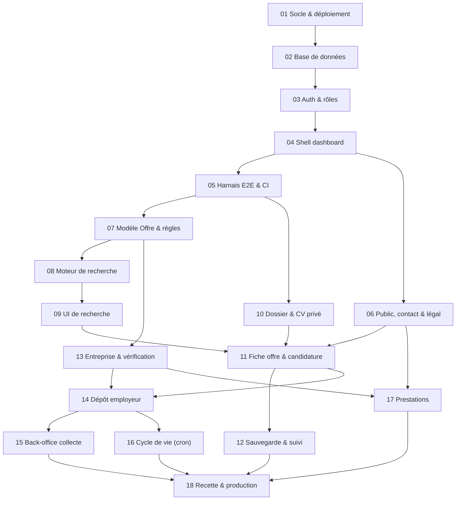

# Plans de réalisation — Job-board saisonnier V1

18 petits plans dépendants pour construire la V1 décrite dans le [cahier des charges](../cahier-des-charges-job-board-saisonnier-v1.md).
Chaque plan tient en une session de travail, se termine par des tests verts et laisse l'application déployable.

> Le cahier des charges est encore à la racine du dossier. Le plan 01 le déplace dans `docs/`, car create-next-app refuse un dossier non vide, sauf `docs/`.

## Stack retenue

Versions vérifiées sur npm le 21/10/2026.

| Besoin | Choix | Raison |
|---|---|---|
| Framework | **Next.js 16.4** (App Router, Turbopack, React 19.3) | demandé ; `proxy.ts` remplace `middleware.ts` |
| UI | **shadcn/ui** (CLI 4.22, base Radix) + bloc **`dashboard-01`** | demandé ; sidebar, header, cartes KPI, graphique et tableau TanStack Table v9 |
| Base de données | **PostgreSQL** : Neon via le Marketplace Vercel (preview et prod), Docker en local | Neon est le Postgres intégré à Vercel ; une branche de base par preview |
| ORM | **Drizzle ORM 0.45** (stable) + drizzle-kit 0.31 | SQL typé ; filtres composables (tableaux, enums) ; adaptateur Better Auth |
| Auth | **Better Auth 1.7** (email + mot de passe, vérification d'email) | données dans notre Postgres ; rôle porté par l'utilisateur |
| Documents (CV) | **Vercel Blob privé** (`@vercel/blob` 2.8, `access: "private"`) | CV jamais public ; téléchargement par une route authentifiée |
| Emails | **Resend** (sortie console en local) | vérification d'email, rappel à 30 jours, notifications au fondateur |
| Tâches planifiées | **Vercel Cron** (quotidien) | échéances et rappel à 30 jours |
| État des filtres | **nuqs 2.10** (paramètres d'URL) | mise à jour immédiate ; recherche partageable |
| Formulaires | **react-hook-form 7.90 + zod 4.6** | mêmes schémas côté client et côté serveur |
| Tests | **Vitest 5** (règles métier) + **Playwright 1.64** (parcours) | les points de contrôle du §9 deviennent des tests |

## Graphe des dépendances

Après le plan 07, deux pistes peuvent avancer en parallèle :

- **piste candidat** : 08 → 09, 10, puis 11 → 12 ;
- **piste employeur** : 13, puis 14 une fois le plan 11 terminé → 15, 16, et 17.

## Les plans

| # | Plan | Dépend de | Taille | Résultat visible | Statut |
|---|---|---|---|---|---|
| 01 | [Socle projet & premier déploiement](01-socle-projet.md) | — | S | dashboard-01 en ligne sur Vercel | ☑ |
| 02 | [Base de données & référentiels](02-base-de-donnees.md) | 01 | M | Postgres local + Neon, migrations, régions/départements/métiers | ☑ |
| 03 | [Authentification & rôles](03-authentification-roles.md) | 02 | M | inscription candidat / employeur, vérification d'email | ☑ |
| 04 | [Shell applicatif par rôle](04-shell-dashboard.md) | 03 | S | sidebar adaptée au rôle | ☑ |
| 05 | [Harnais E2E & CI](05-harnais-tests-e2e.md) | 04 | S | Playwright par rôle + GitHub Actions | ☑ |
| 06 | [Pages publiques, contact & légal](06-pages-publiques-contact.md) | 04 | M | accueil, contact du fondateur, pages légales | ☑ |
| 07 | [Modèle Offre & règles métier](07-modele-offre-regles-metier.md) | 05 | L | schéma des offres, règles testées, données de démo | ☑ |
| 08 | [Moteur de recherche](08-moteur-recherche.md) | 07 | M | `searchOffers` conforme au §4, prouvé | ☑ |
| 09 | [Interface de recherche](09-interface-recherche.md) | 08 | M | filtres dynamiques + critères actifs | ☑ |
| 10 | [Dossier candidat & CV privé](10-dossier-candidat-cv.md) | 05 | M | dépôt et téléchargement du CV privé | ☐ |
| 11 | [Fiche offre & candidature](11-fiche-offre-candidature.md) | 06, 09, 10 | M | fiche « non précisé » + candidature directe | ☐ |
| 12 | [Sauvegarde & suivi](12-sauvegarde-suivi.md) | 11 | S | « Mes offres », « J'ai postulé » | ☐ |
| 13 | [Entreprise & vérification](13-entreprise-verification.md) | 07 | M | rattachement employeur + file de vérification | ☐ |
| 14 | [Dépôt & gestion des annonces](14-depot-annonces-employeur.md) | 11, 13 | L | formulaire structuré + liste employeur | ☐ |
| 15 | [Back-office : collecte & modération](15-back-office-collecte.md) | 14 | M | annonces collectées, référentiels, KPI admin | ☐ |
| 16 | [Cycle de vie (cron)](16-cycle-de-vie-cron.md) | 14 | S | échéances + rappel à 30 jours | ☐ |
| 17 | [Prestations employeurs](17-prestations-employeurs.md) | 06, 13 | S | demandes de prestations + suivi admin | ☐ |
| 18 | [Recette, RGPD & production](18-recette-production.md) | 12, 15, 16, 17 | M | V1 conforme au §9, en production | ☐ |

Taille : **S** = session courte, **M** = une session, **L** = session longue (à découper si besoin).

## Comment exécuter un plan

Dans une nouvelle session Claude Code, à la racine du projet :

> Exécute le plan `docs/plans/NN-….md`. Lis d'abord `CLAUDE.md`, `docs/plans/README.md` (hypothèses et glossaire) et les sections du cahier des charges citées par le plan.

Règles communes :

1. Une branche par plan (`plan/NN-slug`), une PR et une preview Vercel vérifiée avant le merge. Le plan 01 fait exception, car le dépôt n'existe pas encore.
2. Un plan est terminé quand ses critères d'acceptation sont cochés et que `npm run lint && npm run typecheck && npm test` passe. À partir du plan 05, `npm run e2e` doit aussi passer.
3. Ce qui est listé en « Hors périmètre » n'est pas fait.
4. Une ambiguïté métier ne se tranche pas en silence : appliquer l'hypothèse ci-dessous ou en ajouter une nouvelle.
5. Après le merge, cocher la colonne « Statut » ci-dessus.

## Hypothèses par défaut (à valider par le fondateur)

Le cahier des charges laisse ces points ouverts. Les plans appliquent les choix suivants.

| # | Hypothèse | Plans |
|---|---|---|
| H1 | Un compte = un rôle (candidat ou employeur), choisi à l'inscription. Le rôle admin est attribué par un script. | 03 |
| H2 | Chaque rattachement employeur ↔ entreprise est vérifié par l'admin, premier déposant compris. Un déposant vérifié publie ensuite sans modération préalable. Avant la vérification, ses annonces sont « en attente » et invisibles. | 13, 14 |
| H3 | Dossier complet = nom + téléphone + CV PDF (≤ 4 Mo). Les coordonnées de candidature ne sont envoyées au navigateur que si le dossier est complet. | 10, 11 |
| H4 | Dates : par défaut, le contrat doit être entièrement inclus dans la disponibilité. L'option « flexible » accepte un chevauchement. Une offre sans dates précises (durée seule, ou date de début et durée) est exclue dès qu'un critère de dates est actif. | 08 |
| H5 | Salaire : on compare uniquement la base choisie (net ou brut), uniquement les montants **mensuels**, sur la borne basse de la fourchette. Le minimum exige une base ; la base seule ne restreint rien. | 08 |
| H6 | Langues : le critère « langues que je parle » retient les offres sans langue exigée, ou celles dont toutes les langues exigées font partie de la sélection. | 08 |
| H7 | Horaires : temps plein ou partiel, heures hebdomadaires et précisions libres. Le filtre porte sur plein / partiel. À affiner (coupures, travail de nuit…). | 07, 08 |
| H8 | Le critère expérience devient le filtre « Débutants acceptés ». Le critère permis devient le filtre « Permis non exigé ». | 08 |
| H9 | Dépôt employeur : email et/ou téléphone obligatoire, lien officiel facultatif. Liens, emails et sources sont contrôlés contre une liste de domaines exclus, modifiable par l'admin. | 07, 14 |
| H10 | Annonces collectées : en V1, l'admin les saisit via une fonction d'import unique, que le futur scan nocturne réutilisera. Aucun scraping en V1. | 15 |
| H11 | Le CV n'est accessible qu'à son propriétaire. L'admin n'y a pas accès non plus. | 10 |
| H12 | Comme le compte est obligatoire, les offres ne sont pas indexables par les moteurs de recherche. Le référencement repose sur les pages publiques. | 06 |
| H13 | L'intitulé du poste est obligatoire au dépôt ; le métier choisi dans le référentiel reste facultatif. | 07, 14 |
| H14 | Le nom du service n'est pas décidé. Le nom provisoire est centralisé dans `src/config/site.ts`. | 01, 18 |
| H15 | Prestations : les demandes sont enregistrées puis traitées à la main. Ni tarif, ni paiement, ni questionnaire en ligne. | 17 |
| H16 | Une annonce refusée par la collecte automatique (minimum non atteint, domaine exclu) est conservée avec ses motifs dans une file de revue du back-office : aucune n'est écartée en silence. Les contraintes de la table des offres valant pour toute ligne, cette file a sa propre table. | 15 |

## Glossaire : cahier des charges → code

L'interface, les contenus et les URL sont en français ; le code, les tables et les colonnes sont en anglais.

| Cahier des charges | Code |
|---|---|
| Offre, annonce | `offer` |
| Annonce déposée / collectée | `origin`: `deposited` / `collected` (+ `sourceUrl`, `sourceCheckedAt`) |
| Entreprise | `company` |
| Déposant et son lien avec l'entreprise | `companyMember` (`status`: `pending` / `verified` / `rejected`) |
| Candidat, employeur, gestionnaire du service | rôles `candidate`, `employer`, `admin` |
| Dossier candidat | `candidateProfile` |
| Offres sauvegardées, « J'ai postulé » | `offerTracking` (`savedAt`, `appliedAt`) |
| Mode de candidature | `applicationChannel` (`employer` / `recruiter`) + `applyEmail`, `applyPhone`, `applyUrl` |
| Chargé de recrutement | `recruiterName` (personne du service) |
| Anonymat de l'entreprise | `hideCompanyIdentity` (seulement avec `recruiter`) |
| « Non précisé » | `unknown` (enum `tri_state` : `yes` / `no` / `unknown`) |
| Métier | `occupation` |
| Échéances | `applicationDeadline`, `endDate` |
| Job-boards exclus | `blockedDomain` |
| Demande de prestation | `serviceRequest` |
| Message au fondateur | `contactMessage` |

## Hors V1

Ne pas introduire, même partiellement (§5, §8, §9) :

- les alertes et les recherches enregistrées ;
- une CVthèque, l'accès des employeurs aux CV, l'envoi automatique de documents ;
- un pipeline de candidature détaillé ou des relances automatiques ;
- la revendication d'une annonce collectée par un employeur ;
- le scan nocturne automatisé (sa conception est reportée) ;
- les tarifs, le paiement et le questionnaire en ligne des prestations ;
- un annuaire d'employeurs sans offre, des guides ;
- le coaching, le suivi personnalisé et les abonnements candidats (V2).

## Traçabilité

| Section du cahier des charges | Plans |
|---|---|
| §1 Intention et positionnement | 06 |
| §2 Périmètre du catalogue | 02, 07, 14, 15 |
| §3 Informations et règles de publication | 07, 11, 14 |
| §4 Recherche et filtres | 08, 09 |
| §5 Parcours candidat | 03, 10, 11, 12 |
| §6 Dépôts employeurs et exploitation | 13, 14, 15, 16 |
| §7 Modèle économique et services | 11, 15, 17 |
| §8 Éléments reportés | « Hors V1 » ci-dessus, 18 |

| Point de contrôle (§9) | Plans | Preuve prévue |
|---|---|---|
| Aucun parcours de candidature ordinaire ne mène à un job-board exclu | 02, 07, 11, 14, 15 | tests `blocked-domains` ; E2E dépôt refusé ; rendu de la fiche |
| Les filtres se combinent et mettent à jour immédiatement les résultats | 08, 09 | requête SQL comparée à l'oracle ; E2E sur le compteur |
| Les mentions inconnues ne deviennent ni négatives ni confirmées | 07, 08, 09, 11, 14 | tests tri-état et correspondance ; E2E « Non précisé » |
| Net, brut et unités restent distingués | 07, 08, 11 | tests `salary` ; E2E filtre net contre brut |
| Recherche possible sans CV ; dossier exigé pour candidater | 10, 11 | E2E dossier et fiche |
| CV privés, jamais envoyés automatiquement | 10, 11 | E2E d'accès au CV ; aucun envoi |
| Sauvegarde et suivi restent simples | 12 | E2E suivi |
| Échéances dépassées prises en compte | 07, 08, 16 | tests `offer-activity` ; job d'expiration |
| Les modifications d'annonces collectées passent par le fondateur | 06, 11, 14, 15 | lien de contact ; aucun écran employeur ne les modifie |
| Aucune fonctionnalité V2 introduite implicitement | tous, 18 | revue de périmètre |
