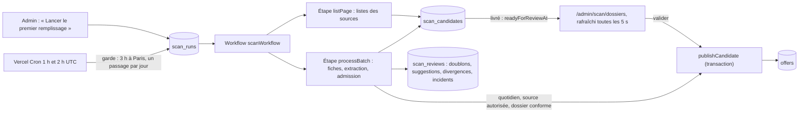
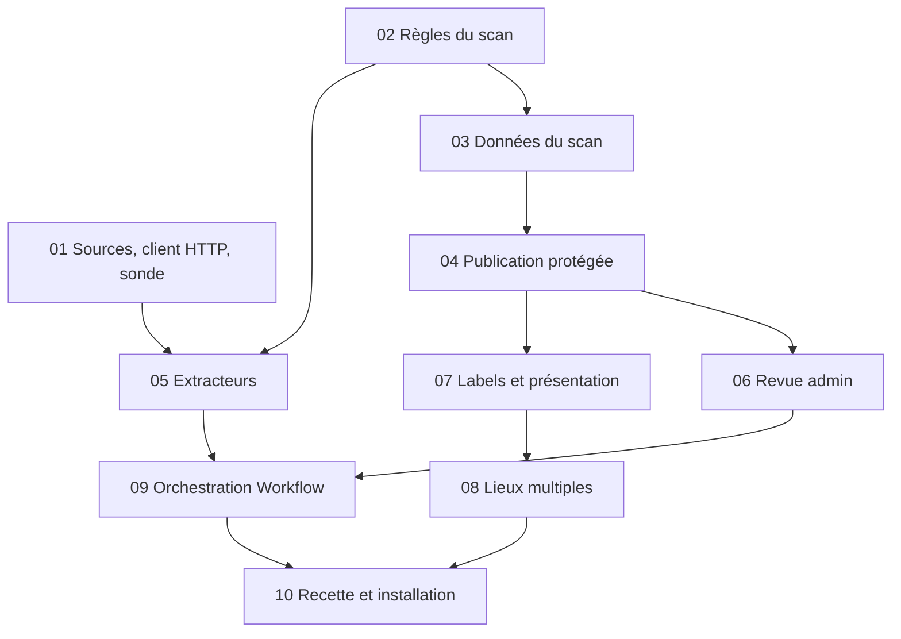

# Plans de réalisation — Scan saisonnier V1

Dix plans pour réaliser la **V1 du scan** décrite par le [plan technique V1–V5](../../plan-technique-scan-v1-v5.md) (§1 à §6), conformément au [cahier des charges du scan](../../cahier-des-charges-scan-saisonnier-v1.md). Ils détaillent les huit lots du §6 du plan technique. Chaque plan tient en une session de travail, se termine par des tests verts et laisse l'application déployable.

Rédigés le 23 octobre 2026 à partir du code de `main` (plans 01 à 17 de l'application terminés). Les plans scan 01 ([PR #32](https://github.com/francoisnoel62/saisonnier/pull/32)) et 02 ([PR #34](https://github.com/francoisnoel62/saisonnier/pull/34)) sont terminés ; l'état courant des plans suivants figure dans le tableau ci-dessous. À la demande du fondateur le 24/10/2026, les plans 04 à 08 sont regroupés dans la [PR #37](https://github.com/francoisnoel62/saisonnier/pull/37), qui remplace les PR empilées #38 à #41. Les quatre mesures de preview, la confirmation du correctif MS Vacances `teamtailor@2` et la réévaluation du réservoir sont consignées. Aucun passage de collecte n'est installé ni programmé avant les plans 09 et 10.

## Résultat attendu

- **Recette de la V1** : au moins **50 dossiers distincts et exploitables livrés dans la file admin en moins de six heures** après le lancement du premier remplissage en production, sans frais de fournisseur hors Vercel. La vérification humaine et la publication sont mesurées à part ; elles ne conditionnent pas l'objectif.
- **Livraison au fil de l'eau** : chaque dossier est consultable et traitable dès son enregistrement, pendant que la collecte continue. La file se rafraîchit toutes les 5 secondes sans remplacer le dossier ouvert ni perdre la saisie.
- **Ensuite** : un passage quotidien vers 3 h (Europe/Paris), sur une fenêtre fixe de 72 heures, sans rattrapage ni nouvel amorçage.
- **Sans LLM** : sources employeurs préparées, extraction par code, règles explicites ; l'admin tranche ce que les règles ne savent pas établir.

## Architecture retenue

| Couche | Emplacement | Rôle |
|---|---|---|
| Règles pures | `src/domain/scan/` | fenêtre, dates source, contrat, période, canal, conditions, admission, points à vérifier, identité d'un recrutement, comptage |
| Accès réseau | `src/server/scan/http.ts` | client HTTP borné : adresses publiques seulement, robots.txt, délais, taille, politesse |
| Sources | `src/server/scan/sources/` | registre en code (`scanSourceDefinitions`) et adaptateurs par format : ils renvoient des observations prouvées, jamais une décision |
| Données | `src/server/scan/` | passages, pistes et dossiers, livraison, publication, doublons, revue |
| Orchestration | `src/workflows/` | `scanWorkflow` et ses étapes durables (Vercel Workflow) |
| Déclenchement | `/admin/scan`, `src/app/api/cron/scan/route.ts` | lancement immédiat par l'admin, cron quotidien |
| Revue | `src/app/(app)/admin/scan/` | file, preuves, formulaire d'annonce prérempli, suggestions, bilan |

Principes transversaux :

- **Un adaptateur observe, une règle décide, un service écrit.** L'admission dans la file et la conformité à la publication sont deux décisions distinctes ; la publication revérifie tout dans sa transaction.
- **Une livraison = une transaction courte par dossier.** Aucune transaction n'englobe une source ou un lot ; un dossier livré reste traitable si la suite échoue.
- **Tout est rejouable.** Les étapes Workflow peuvent être réessayées : chaque écriture est conditionnée par un statut (ou une version), le compteur ne double jamais, une publication déjà faite est constatée.
- **Aucune écriture silencieuse sur une annonce existante.** Une redécouverte ne remet rien en ligne et ne modifie rien ; une différence devient une divergence soumise à l'admin.

## Graphe des dépendances

Deux pistes peuvent avancer en parallèle : **01 → 05** (sources et extracteurs) et **02 → 03 → 04 → 06** (données et revue). Les plans 07 et 08 peuvent suivre 04 en parallèle de 06. Le plan 10 exige tous les autres : aucune annonce issue du scan n'est publiée en production avant que les labels, le badge « Candidature externe » et les lieux multiples soient en place.

## Les plans

| # | Plan | Dépend de | Taille | Lot du plan technique | Résultat visible | Statut |
|---|---|---|---|---|---|---|
| 01 | [Sources, client HTTP sûr et sonde](01-sources-client-http.md) | — | M | 1 | sonde exécutée depuis la preview, registre, fixtures anonymisées, dossier des sources | ☑ |
| 02 | [Règles du scan](02-regles-scan.md) | — | M | 2 | règles pures testées : 72 h, dates, contrat, période, canal, admission | ☑ |
| 03 | [Données du scan](03-donnees-scan.md) | 02 | M | 2 | tables, passages uniques, livraison et compteur idempotents | ☑ |
| 04 | [Publication protégée](04-publication-protegee.md) | 03 | M | 3 | publication unique et rejouable, doublons et divergences en revue, retraits préservés | ☑ |
| 05 | [Extracteurs](05-extracteurs.md) | 01, 02 | L | 4 | dossiers préremplis depuis les fixtures, qualité mesurée en preview | ☑ |
| 06 | [Revue admin et suggestions](06-revue-admin.md) | 04 | L | 5 | file « À vérifier » actualisée, revue préremplie, décisions, suggestions de métiers | ☑ |
| 07 | [Labels et présentation](07-labels-presentation.md) | 04 | M | 6 | labels de provenance, « Candidature externe », dates, « À confirmer », « Divers » | ☑ |
| 08 | [Lieux multiples](08-lieux-multiples.md) | 07 | M | 6 | une fiche à plusieurs lieux, trouvée par chacun, comptée une fois | ☑ |
| 09 | [Orchestration durable](09-orchestration-workflow.md) | 03, 05, 06 | L | 7 | lancement admin, cron quotidien, lots bornés, reprise, arrêt, bilan | ☐ |
| 10 | [Recette et installation](10-recette-installation.md) | 01 à 09 | M | 8 | 50 dossiers livrés avant T+6 h en production, puis scan quotidien actif | ☐ |

Taille : **S** = session courte, **M** = une session, **L** = session longue (à découper si besoin).

## Comment exécuter un plan

Dans une nouvelle session Claude Code, à la racine du projet :

> Exécute le plan `docs/plans/scan-v1/NN-….md`. Lis d'abord `CLAUDE.md`, `docs/plans/README.md`, `docs/plans/scan-v1/README.md` (hypothèses et glossaire), puis les sections du cahier des charges du scan et du plan technique citées par le plan.

Règles communes, en plus de celles de `docs/plans/README.md` :

1. Une branche par plan (`plan/scan-NN-slug`), une PR, une preview Vercel vérifiée avant le merge. Après le merge, supprimer la branche Neon de la preview (10 branches au plus).
2. Terminé : critères d'acceptation cochés, et `npm run lint`, `npm run typecheck`, `npm test`, `npm run test:int` et `npm run e2e` passent.
3. Chaque plan met à jour `CLAUDE.md` pour ce qu'il introduit (tables, modules, commandes, conventions), comme les plans précédents.
4. Les tests utilisent des fixtures, jamais les sites réels. Seules la sonde (plans 01 et 05) et la recette (plan 10) touchent les sources, depuis une preview ou la production.
5. Avant d'utiliser une API de Next, du SDK Workflow ou d'une bibliothèque nouvelle, lire sa documentation installée ou officielle ; les versions citées ont été relevées le 23 octobre 2026 et se revérifient à l'installation.
6. Une ambiguïté métier ne se tranche pas en silence : appliquer une hypothèse ci-dessous ou en ajouter une.

## Hypothèses du scan (à valider par le fondateur)

Elles complètent les hypothèses H1–H20 de l'application. **H10** (« aucun scraping ») est levée pour le seul scan par ces plans ; **H16** est réalisée par la table des dossiers du scan ; **H19** reste vraie pour la saisie au back-office, le scan passant par la revue ou par son propre service de publication.

| # | Hypothèse | Plans |
|---|---|---|
| SH1 | **Levée par SH20** ([plan scan V2-01](../scan-v2/01-gestion-des-sources.md), lot A : registre en base). Le registre des sources est en code (`scanSourceDefinitions` : URL, adaptateur, hôtes officiels, preuve de rattachement, SIREN, conditions de reprise, limites). La table `scan_sources` ne porte que l'état modifiable par l'admin (activée, publication automatique), comme `scheduled_jobs`. Toute source démarre désactivée. La gestion complète des sources dans l'admin relève de la V2. | 01, 03 |
| SH2 | Un seul passage actif à la fois. Un cron qui survient pendant un passage ne démarre rien et l'indique dans son résumé ; le passage quotidien suivant garde sa fenêtre de 72 h. | 03, 09 |
| SH3 | Le remplissage initial est unique (`runKey = "bootstrap"`). « Reprendre » relance ce même passage, avec la même échéance T+6 h et le même compteur. Il ne publie jamais automatiquement. | 03, 09 |
| SH4 | La publication automatique n'existe qu'en passage quotidien, pour une source dont l'admin a activé « Publication automatique » (désactivée par défaut), et pour un dossier sans aucun point bloquant ni doublon potentiel. Elle porte le label « Sourcée sur internet ». | 02, 04, 09 |
| SH5 | Un dossier compte au moment de sa livraison (`readyForReviewAt`) et le cumul ne décroît jamais. Un rejet de l'admin pour un motif d'admission (hors périmètre, offre close, doublon, sans contenu) ne retire rien du compteur, mais le bilan calcule aussi un « seuil confirmé » sans ces dossiers. La recette exige les deux avant T+6 h. | 03, 09, 10 |
| SH6 | Lieux multiples : le lieu principal reste dans `offers` ; les lieux supplémentaires vont dans `offer_locations`. Aucune migration des offres existantes. En V1, seuls l'admin et le scan saisissent plusieurs lieux. | 08 |
| SH7 | « À confirmer » : un champ facultatif contradictoire est enregistré à sa valeur neutre (`unknown`, vide) et listé dans `fieldsToConfirm`. Il s'affiche « À confirmer » et ne satisfait aucun filtre. Saisir une valeur établit le champ et retire la mention. | 07 |
| SH8 | Labels : « Vérifiée par un humain » pour toute annonce collectée dont la publication a été décidée par l'admin (revue du scan ou saisie au back-office, y compris les annonces déjà en base) ; « Sourcée sur internet » pour une publication automatique ; « Recruteur vérifié » pour une annonce déposée depuis un compte employeur ; « Déposée par l'employeur » pour une annonce déposée saisie par le fondateur. | 04, 07 |
| SH9 | Un contact général trouvé sur le site (accueil, réception) reste une preuve du dossier ; il n'est pas publié en V1. Le canal publié reste le formulaire officiel, avec « Candidature externe ». | 02, 07 |
| SH10 | Le champ « Divers » (`additionalInfo`) reçoit les informations documentées sans champ prévu. Seuls l'admin et le scan le renseignent. | 07 |
| SH11 | Passage quotidien : deux crons, `0 1 * * *` et `0 2 * * *` (UTC), avec une garde « il est 3 h à Paris » et l'unicité par jour de Paris. Un seul démarre, entre 3 h et 3 h 59 à Paris, été comme hiver, malgré la précision horaire de l'offre Hobby. | 09 |
| SH12 | Politesse : une requête à la fois par domaine, 2 s au moins entre deux requêtes (ou le `Crawl-delay`, s'il est plus long), robots.txt respecté, `Retry-After` honoré, arrêt de la source sur 401/403 ou refus de robots.txt, sans contournement. Le User-Agent nomme le service et sa page de contact. | 01, 09 |
| SH13 | Conservation : 20 000 caractères de texte utile et 200 observations par dossier au plus. Le texte et les observations des dossiers écartés ou rejetés sont effacés après 90 jours ; leurs métadonnées restent. | 03, 09 |
| SH14 | Les fixtures sont des pages réelles anonymisées : structure conservée, noms de personnes, emails et téléphones remplacés par des valeurs fictives (`.example`, tranches de fiction du `CLAUDE.md`). | 01, 05 |
| SH15 | Le scan ne crée jamais d'entreprise. Il propose celle du registre (par SIREN) si elle existe en base ; sinon l'admin crée la fiche pendant la revue. Un portail de groupe n'impose pas son entreprise à toutes ses offres. | 05, 06, 09 |
| SH16 | Notifications : un email au fondateur à la fin d'un passage qui a livré des dossiers ou rencontré un incident nouveau, et quand le remplissage initial ne peut plus atteindre 50 avec les sources actives. Jamais un email par dossier. | 09 |
| SH17 | Arbitrage du fondateur du 23/10/2026 pendant le plan 01 : France Travail devient la source de découverte prioritaire, avec la recherche fournie (France, domaine G, contrat SAI, création depuis trois jours, sans offres partenaires, tri par date). Exception ciblée au report des job-boards en V3. `kind = "discovery"` porte un employeur et un site employeur nuls ; un diffuseur n'est jamais l'employeur d'une offre. **Choix d'implémentation, à valider par le fondateur** (hors de sa décision consignée) : le HTML de liste et le JSON public du composant officiel (`/api-descriptifoffre/`) sont lus sans navigateur ni API partenaire authentifiée ; la validation couvre aussi le cadre d'une extraction systématique (CGU, droit du producteur de base de données). La source officielle employeur et les conditions de publication restent à établir avant publication. Les autres portails restent en réserve, sans activation automatique. | 01, 05 |
| SH18 | Règles déterministes du plan 02 : années déduites toujours bloquantes ; durée calendaire jusqu'au jour anniversaire ou à sa veille ; heure locale ambiguë non choisie sans décalage ; échéance civile valable jusqu'à la fin de son jour ; hôtes officiels exacts ; destination exclue bloquante même avec un autre canal ; périodes établies disjointes prioritaires dans l'identité. Détails et contrat d'intégration : [règles V1](../../scan/rules-v1.md). | 02 |
| SH19 | Décision explicite du fondateur du 24/10/2026 pendant le plan 06 : été/hiver devient facultatif dans la publication et les formulaires. La nature saisonnière du contrat reste obligatoire ; une saison absente ou contradictoire ne bloque pas. La valeur reste `NULL`, sans déduction forcée. | 06 |

## Glossaire : cahier des charges du scan → code

| Cahier des charges | Code |
|---|---|
| Passage (remplissage initial, passage quotidien) | `scanRun` (`mode` : `bootstrap` / `daily`), table `scan_runs` |
| Source (portail officiel d'un employeur) | `scanSource` : registre `scanSourceDefinitions`, état `scan_sources` |
| Adaptateur | `ScanAdapter` |
| Piste, dossier | `scanCandidate`, table `scan_candidates` |
| Observation, preuve | `Observation`, `Evidence` |
| Livré pour vérification | `status = "to_review"`, `readyForReviewAt` |
| Écarté (non admis dans la file) | `status = "excluded"`, `exclusionReason` |
| Point à vérifier (bloquant), alerte (non bloquante) | `ScanIssue` (`scanIssueCodes`, `blocking`) |
| Seuil atteint | `targetReachedAt` |
| Doublon potentiel, divergence, incident, suggestion de métier | `scan_reviews` (`kind` : `duplicate`, `divergence`, `incident`, `occupation`) |
| Alias de métier validé | `occupation_aliases` |
| Identité d'un recrutement | `identityKey` + `generation` |
| Date de publication source, date de découverte | `sourcePublishedDate`, `sourcePublishedAt`, `firstDiscoveredAt` |
| « Vérifiée par un humain », « Sourcée sur internet » | `humanVerifiedAt` renseigné ou non ; `publicationKind` (`human` / `automatic`) côté dossier |
| « Candidature externe » | `isExternalApplication(offer)` |
| « À confirmer » | `fieldsToConfirm` |
| « Divers » | `additionalInfo` |
| Lieux supplémentaires | `offer_locations` |

## Réglages par défaut

Ils se règlent dans le registre (par source) ou dans `src/domain/scan/limits.ts` (globaux), et s'ajustent sur mesures.

| Réglage | Valeur | Raison |
|---|---|---|
| Requêtes simultanées par domaine | 1 | politesse (SH12) |
| Domaines traités en parallèle | 3 | quelques sources à la fois, sans pic |
| Intervalle minimal entre deux requêtes d'un domaine | 2 s, ou le `Crawl-delay` s'il est plus long | politesse |
| Délai maximal d'une requête | 15 s, comptées depuis l'envoi (attente de politesse exclue) | une source lente ne bloque pas le lot |
| Recul après un 429 sans `Retry-After` | 60 s | politesse (SH12) |
| Budget de la sonde admin | 100 s pour la liste et trois fiches | sous la durée maximale de `/admin/scan` (120 s) |
| Taille maximale d'une réponse | 2 Mo après décompression | borne mémoire et stockage |
| Redirections | 5 au plus, chacune revalidée | sécurité |
| Essais par piste | 3 en cas d'échec temporaire | reprises bornées |
| Budget d'une étape de lot | 120 s | marge sous la limite de 300 s des fonctions Hobby |
| Pages de liste par source et par passage | 20 | borne V1 ; la pagination exhaustive relève de la V2 |
| Pistes lues par source et par passage | 400 | borne V1 |
| Rafraîchissement de la file | 5 s, écran visible et passage actif ; immédiat au retour sur l'écran | plan technique §5 |
| Cible et échéance du remplissage initial | 50 dossiers, T0 + 6 h | recette |
| Fenêtre quotidienne | 72 h avant le début du passage, borne incluse | cahier §3 |

## Plateforme : limites et coûts relevés le 23 octobre 2026

- **Vercel Workflow** (`workflow` 5.2.3 sur npm) : l'offre Hobby inclut chaque mois 50 000 « Workflow Events » et 1 Go de « Workflow Data Written ». Une étape produit au moins trois événements, plus un par réessai. 10 000 étapes au plus par run ; une étape dure au plus la limite des fonctions (300 s en Hobby) ; données d'un run conservées un jour après sa fin en Hobby. Le projet doit exposer les variables système (« Enable access to System Environment Variables »), sinon le déploiement retombe sur le stockage local et chaque run échoue. Sources : [Workflows](https://vercel.com/docs/workflows), [tarifs et limites](https://vercel.com/docs/workflows/pricing), [conservation](https://vercel.com/docs/workflows/retention), [démarrage Next.js](https://workflow-sdk.dev/docs/getting-started/next).
- **Vercel Cron** : en Hobby, un cron s'exécute au plus une fois par jour, n'importe quand dans l'heure prévue ; en Pro, à la minute. Aucun réessai en cas d'échec ; la livraison est « au mieux », un même créneau peut être invoqué deux fois et deux exécutions peuvent se chevaucher. Les crons ne s'exécutent que sur la production. Sources : [tarifs des crons](https://vercel.com/docs/cron-jobs/usage-and-pricing), [gestion des crons](https://vercel.com/docs/cron-jobs/manage-cron-jobs), [démarrage](https://vercel.com/docs/cron-jobs/quickstart).
- **Estimation à confirmer au plan 10** : un remplissage initial sur quatre sources représente de l'ordre de 60 étapes (environ 200 événements) ; un passage quotidien, autant. Moins de 10 000 événements par mois : dans l'allocation Hobby. Garder des entrées et sorties d'étapes minuscules (identifiants, compteurs) : le HTML ne transite jamais par le Workflow.
- L'offre Hobby reste réservée à un usage non commercial : le passage en Pro est déjà prévu par le plan 18 de l'application.

## Hors périmètre de la V1 du scan

- Recherche Web (Tavily, Brave), API ou pages de job-boards et d'agrégateurs (Indeed, LinkedIn, EasyJobs, Arbeitnow…) : V3. France Travail fait l'objet de l'exception ciblée SH17 demandée par le fondateur ; son API partenaire restreinte n'est pas intégrée.
- Catalogue exhaustif par entreprise, pagination complète avec curseurs persistants, gestion des sources dans l'admin : V2.
- Navigateur automatisé, PDF, nouveaux formats d'ATS sans échantillon, preuve surlignée, comparaison de versions, actions groupées : V4.
- Planification par rendement, carte de couverture : V5.
- Cron de contrôle des annonces publiées (disparitions, modifications, retraits à la source) : chantier séparé (§8 du cahier).
- Mise en avant payante ; toute brique LLM ; revendication d'une annonce par un employeur.
- Brouillon de revue (enregistrer un dossier sans décider), publication du contact général, plusieurs lieux saisis par l'employeur.

## Traçabilité

| Lot du plan technique (§6) | Plans |
|---|---|
| 1. Échantillon et sources | 01, mesure complétée par 05 |
| 2. Dossiers et règles | 02, 03 |
| 3. Publication protégée | 04 |
| 4. Extraction initiale | 05 |
| 5. Revue et suggestions | 06 |
| 6. Présentation et filtres | 07, 08 |
| 7. Orchestration | 09 |
| 8. Recette et installation | 10 |

| Cas de vérification du cahier (§10) | Plans | Preuve prévue |
|---|---|---|
| Offre horodatée exactement 72 h avant le début du passage | 02, 03 | test `window` ; date réelle conservée |
| Premier lancement du scan | 09, 10 | E2E de lancement ; compte rendu de recette |
| Dossier initial complet, en apparence publiable | 02, 04, 09 | `canAutoPublish` faux en mode initial ; test de workflow |
| Texte utile mais période ou source officielle à établir | 02, 06 | test d'admission ; E2E « validation bloquée » |
| Admin absent pendant les six heures | 09, 10 | test de workflow ; recette |
| Premier dossier prêt alors que la collecte continue | 06, 09 | E2E de livraison progressive |
| Nouvelle annonce pendant une saisie | 06, 09 | E2E « saisie préservée » |
| Revue commencée avant la fin de la collecte | 03, 06 | compteur cumulé ; décision préservée après reprise |
| Admin qui ferme l'écran ou source en échec | 09 | E2E ; test de passage partiel |
| Passage quotidien après le remplissage initial | 02, 09 | fenêtre de 72 h ; aucun nouvel amorçage |
| Reprise après cinq jours d'arrêt | 02, 09 | test `window` : 72 h seulement |
| Annonce sans date de publication | 02, 07 | « découverte le … » sur le dossier et la fiche |
| Source officielle illisible | 02, 05 | piste échouée ou dossier « fiche illisible », jamais publiée |
| Contrat seulement qualifié de CDD | 02 | test `contract` : à vérifier |
| Ni salaire ni logement | 02, 04, 07 | « Non précisé » ; publication possible |
| Deux salaires contradictoires | 02, 07 | « À confirmer », exclu des filtres, alerte |
| Métier absent du référentiel | 06 | suggestion non bloquante |
| Métier sans famille existante | 06 | création avec une nouvelle famille |
| Métier déjà présent sous un autre intitulé | 06 | alias, sans doublon de référentiel |
| Suggestion déjà traitée retrouvée | 06 | aucune nouvelle entrée |
| Validation d'une seule suggestion | 06, 07 | classement mis à jour, pas de label humain |
| Formulaire officiel seul | 02, 07 | badge « Candidature externe » |
| Formulaire seulement sur un job-board | 02, 04 | domaine exclu : publication bloquée |
| Téléphone d'accueil et formulaire officiel | 02, 07 | contact général non publié (SH9), badge affiché |
| Piste déjà enregistrée qui revient | 03 | même dossier, aucune livraison nouvelle |
| Deux annonces semblant correspondre au même recrutement | 04, 06 | revue `duplicate`, aucune fusion |
| Recrutement déjà déposé dans l'application | 04 | rapprochement soumis, annonce déposée intacte |
| Même employeur et métier, périodes différentes | 02, 04 | deux recrutements distincts |
| Ancien texte contredisant une correction | 04 | divergence signalée, correction préservée |
| Annonce retirée par le fondateur | 04 | aucune remise en ligne |
| Validation sans modification | 06, 07 | « Vérifiée par un humain », date conservée |
| Formulaire seul validé | 07 | label humain et badge |
| Employeur qui s'inscrit | 07 | « Recruteur vérifié » |
| Source en échec alors que d'autres livrent | 09 | passage partiel, dossiers conservés |
