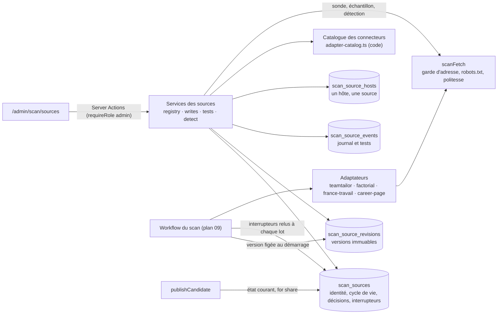
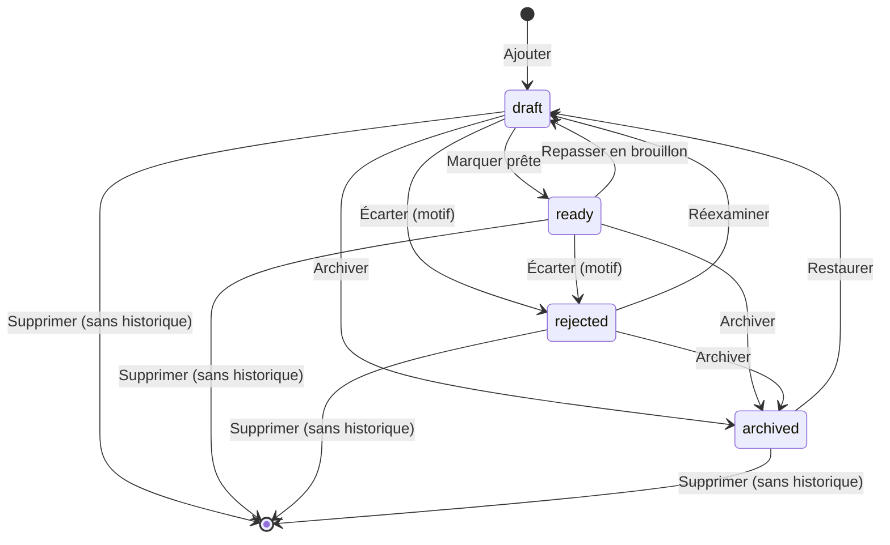
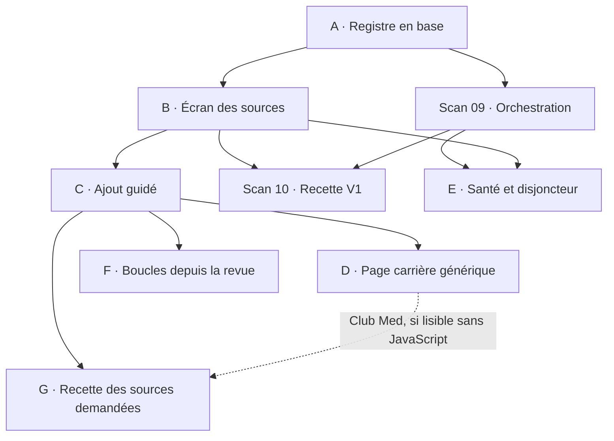

# Plan scan V2-01 — Gestion des sources du scan depuis l'admin

| Dépend de | Débloque | Taille | Références |
|---|---|---|---|
| scan 01 à 08 (terminés) | scan 09 (versions figées des sources), scan 10 (recette depuis l'écran des sources), suite de la V2 (catalogue par entreprise) | XL : sept lots d'une session (A à G) | [plan technique](../../plan-technique-scan-v1-v5.md) §7 (V2 : « gestion des sources dans l'admin », « mutualiser un connecteur »), §8 (V3 : agrégateurs) ; [cahier du scan](../../cahier-des-charges-scan-saisonnier-v1.md) §1, §4, §6 ; cahier job-board §2 ; SH1, SH12, SH15, SH17, SH18 ; [dossier des sources V1](../../scan/sources-v1.md) ; [recherche des sources](../../recherche-sources-scan-sans-ia.md) |

Rédigé le 27 octobre 2026 sur `main` (`ae31948` : plans scan 01 à 08 terminés, 09 et 10 à faire). Premier plan de la V2 du scan, anticipé à la demande du fondateur : l'admin veut **gérer, ajouter, modifier et supprimer facilement des sources** (France Travail, VVF, Belambra, Club Med, Indeed, SeasonJobs, JobAnim…).

## État de réalisation (28 octobre 2026)

| Lot | PR | État |
|---|---|---|
| A · Registre en base | #43 | fusionné ; production migrée (`0017` à `0019`) ; relevé §17.1 consigné dans la PR |
| B · Écran des sources | #50 (reprise de #44) | fusionné |
| C · Ajout guidé | #45 | fusionné ; chronométrage en preview au lot G |
| D · Page carrière, recherches France Travail multiples | #46 | fusionné ; fixtures réelles à choisir avec le fondateur ; connecteur `france-travail-api` sur décision (§19) |
| F · Apprentissage depuis la revue | #47 | fusionné |
| E · Santé et disjoncteur | #48 | fusionné ; déclenchement en fin de passage par le plan scan 09 (contrat dans `CLAUDE.md`) |
| G · Recette | #49 | protocole et compte rendu dans [`docs/scan/recette-sources.md`](../../scan/recette-sources.md) : à mener par le fondateur depuis la production |

## En bref

- **La source devient une donnée, le connecteur reste du code.** Les adaptateurs Teamtailor et Factorial lisent déjà n'importe quel portail de leur format : il ne manque qu'un écran et un registre en base. Ajouter un employeur sur un format connu, ou une recherche France Travail, prend quelques minutes, sans PR ni déploiement.
- **Cycle de vie explicite** : Brouillon → Prête → Activée ; Écartée (avec motif) ; Archivée. « Supprimer » efface une source sans historique ; sinon elle s'archive, pour ne jamais rendre orphelin un dossier, une décision ou une annonce.
- **Chaque modification crée une version immuable.** Un passage lit la version figée à son démarrage ; une source prête ne reçoit jamais une configuration non testée.
- **La qualification entre dans l'application** : rattachement, conditions de reprise, décision du fondateur, accès et extraction vérifiés depuis le déploiement, journal daté. L'activation en dépend ; aujourd'hui, une source « reprise à valider » s'active d'un clic.
- **Un job-board n'est qu'une découverte** (France Travail, Indeed, SeasonJobs, JobAnim) : domaine exclu obligatoire, jamais de publication automatique, passages quotidiens seulement avec une justification d'accès écrite. Indeed est enregistré « Écartée » faute d'accès autorisé.
- **Ordre recommandé** : lot A avant le plan scan 09. La production n'a encore aucun passage : migrer le registre est sans risque aujourd'hui, coûteux après la recette. Lots B et C en parallèle du plan 09 ; lot E après lui.

## Sommaire

1. [Objectif](#1-objectif)
2. [Point de départ](#2-point-de-départ)
3. [Principes et décisions](#3-principes-et-décisions)
4. [Hypothèses SH20 à SH30](#4-hypothèses-sh20-à-sh30-à-valider-par-le-fondateur)
5. [Les sources demandées](#5-les-sources-demandées)
6. [Architecture cible](#6-architecture-cible)
7. [Modèle de données](#7-modèle-de-données)
8. [Connecteurs](#8-connecteurs)
9. [Motifs d'URL simplifiés](#9-motifs-durl-simplifiés)
10. [Cycle de vie, qualification et portes](#10-cycle-de-vie-qualification-et-portes)
11. [Écrans](#11-écrans)
12. [Actions serveur et services](#12-actions-serveur-et-services)
13. [Sécurité, conformité et politesse](#13-sécurité-conformité-et-politesse)
14. [Incidences sur l'existant et sur les plans scan 09 et 10](#14-incidences-sur-lexistant-et-sur-les-plans-scan-09-et-10)
15. [Lots de réalisation](#15-lots-de-réalisation)
16. [Stratégie de tests](#16-stratégie-de-tests)
17. [Migration, déploiement et retour arrière](#17-migration-déploiement-et-retour-arrière)
18. [Risques et parades](#18-risques-et-parades)
19. [Décisions attendues du fondateur](#19-décisions-attendues-du-fondateur)
20. [Hors périmètre](#20-hors-périmètre)
21. [Pistes au-delà de ce plan](#21-pistes-au-delà-de-ce-plan)
22. [Annexes](#22-annexes)

## 1. Objectif

À la fin du plan, depuis `/admin/scan/sources`, sans PR ni déploiement, l'admin peut :

1. **voir** toutes les sources : type, connecteur, statut, interrupteurs, santé, dernier test, rendement ; les filtrer, les chercher, les ordonner ;
2. **ajouter** une source à partir d'une URL : détection du connecteur, identité de l'employeur par l'API Recherche d'entreprises, preuves de rattachement et de reprise, test depuis le déploiement ;
3. **modifier** une source : nouvelle version, motif, comparaison et retour à une version antérieure ;
4. **tester** l'accès (sonde) et l'extraction (échantillon), avec un historique conservé ;
5. **qualifier puis activer** : remplissage initial, passages quotidiens, publication automatique ; chaque interrupteur explique ce qui le bloque ;
6. **écarter, archiver, restaurer, supprimer**, sans jamais perdre un dossier, une décision ou une annonce.

L'admin n'écrit pas de connecteur : un format inconnu reste un développement, que l'écran sait signaler (« connecteur à développer »). Ni navigateur automatisé, ni recherche Web, ni contournement d'un refus d'accès (§20).

| Indicateur de réussite | Cible | Preuve |
|---|---|---|
| Ajouter un portail Teamtailor ou Factorial, ou une recherche France Travail, jusqu'à « Prête » | moins de 10 minutes, aucun déploiement | chronométré au lot G |
| Sources activées avec qualification complète et test réussi de leur configuration courante | 100 % | CHECK et portes, tests d'intégration |
| Modifications attribuées, datées et motivées | 100 % | versions et journal |
| Régression des plans scan 01 à 08 | aucune | suite existante verte à chaque lot |

## 2. Point de départ

État du code de `main` au 27/10/2026.

| Élément | Aujourd'hui | Limite |
|---|---|---|
| Registre | `scanSourceDefinitions` (`src/server/scan/sources/registry.ts`) : France Travail, Belambra, VVF, MS Vacances, plus `fixture` si `SCAN_TEST_SOURCE_URL` | ajouter ou modifier une source exige une PR et un déploiement |
| État | `scan_sources` : `key`, `enabled`, `auto_publish`, `updated_by_user_id` (`state.ts`) | ni historique ni motif ; les deux interrupteurs ne connaissent aucune condition |
| Validation | `scanSourceSchema`, `validateScanSourceRegistry` exécutés par `registry.test.ts` | validation au test, pas à la saisie |
| Connecteurs | `teamtailor@2`, `factorial@1`, `france-travail@3`, `fixture@1` ; `smartrecruiters` → `null` | Teamtailor et Factorial sont déjà génériques : seule la configuration manque |
| Sonde et échantillon | `probeScanSourceAction`, `sampleScanSourceAction` ; panneau `Sheet` et journaux `[scan sonde]`, `[scan échantillon]` | rien n'est conservé : les mesures sont recopiées à la main dans `docs/scan/sources-v1.md` |
| Qualification | prose de `sources-v1.md` (rattachement, CGU, robots.txt, décisions) | aucune règle d'activation : « autorisation de reprise à valider avant activation » n'est contrôlé par rien |
| France Travail | décision du 23/10/2026 : aucun passage programmé en production sans API officielle ou avis juridique écrit | condition écrite, que le plan 09 devait vérifier à la main |
| Consommateurs du registre | `actions.ts`, `publication.ts` (hôtes officiels, `sourceName`), `snapshot.ts` (libellés), `dossiers/[id]/page.tsx`, `state.ts`, tests (`adapter-test-fixtures.ts`, `registry.test.ts`) | lecture synchrone d'une constante de module |
| Intégrité | `scan_candidates.source_key`, `scan_run_sources.source_key`, `scan_reviews.source_key` sans clé étrangère | une source retirée du code laisse des « Source inconnue » |
| Doublons entre sources | unicité (`source_key`, `identity_key`, `generation`) | deux sources sur le même hôte livreraient deux dossiers pour la même annonce |
| Production | aucun code hors des tests ne crée de passage (plans 09 et 10 non faits) : `scan_runs`, `scan_run_sources` et `scan_candidates` doivent être vides, ce que le §17 vérifie ; `scan_sources` contient au plus l'état des quatre sources | fenêtre idéale pour migrer |

## 3. Principes et décisions

**D1 — Le code garde les connecteurs, la base garde les sources.** Un connecteur (`adapter`, `ScanAdapter`) sait lire un format : flux Teamtailor, portail Factorial, recherche France Travail, page carrière. Une source en est une configuration : URL, hôtes officiels, employeur, preuves, limites, alias de lieux, décisions. Les adaptateurs lisent déjà tout dans `ctx.source` : seule l'origine de la définition change.

**D2 — Supprimer, c'est archiver dès qu'un historique existe.** Les références à une source deviennent des clés étrangères `restrict`. Une source jamais lue par un passage (brouillon créé par erreur, source écartée sans essai) se supprime réellement. Les autres s'archivent : plus lues, masquées par défaut, restaurables ; leurs dossiers restent traitables, leurs annonces publiées inchangées. La clé d'une source archivée n'est jamais réattribuée.

**D3 — Versions immuables, passage figé.** Toute modification de configuration écrit une version (`scan_source_revisions`) ; la ligne de la source pointe la version courante. `initRunSources` fige la version de chaque source au démarrage du passage : une étape rejouée lit exactement la même configuration (« tout est rejouable », README du scan). Les interrupteurs, eux, sont relus à chaque lot : désactiver une source l'arrête à la fin de son lot en cours.

**D4 — Une source prête ne reçoit jamais une configuration non testée.** Les champs qui changent ce qui est lu (connecteur, paramètres, listes, motif des fiches, hôtes officiels) forment une empreinte (`config_hash`). Sondes et échantillons enregistrent l'empreinte testée. Enregistrer une telle modification sur une source prête exige un échantillon réussi de cette empreinte depuis moins d'une heure ; sinon l'admin choisit explicitement « Repasser en brouillon ».

**D5 — Qualifier avant d'activer.** « Prête » exige connecteur disponible, configuration complète, preuve de rattachement (ou provenance du diffuseur), conditions de reprise consultées, décision de reprise du fondateur, échantillon réussi de la configuration courante depuis moins de 30 jours et cohérence avec les domaines exclus. « Activée » exige « Prête ». La règle formalise ce que `sources-v1.md` exigeait en prose.

**D6 — Un job-board n'est qu'une découverte.** `kind = "discovery"` (SH17) : employeur nul ; hôtes couverts par un domaine exclu, sinon l'assistant fait ajouter le domaine ; jamais de publication automatique (CHECK) ; passages quotidiens seulement avec une justification d'accès écrite. Cette dernière règle encode la décision du 23/10/2026 sur France Travail. Inversement, une source employeur ne peut pas être hébergée sur un domaine exclu.

**D7 — Un hôte officiel appartient à une seule source non archivée.** Deux sources sur un même hôte livreraient deux dossiers par annonce et doubleraient la charge du site. Table `scan_source_hosts`, clé primaire `host`. Plusieurs recherches France Travail vivent donc dans une même source (lot D). Seule l'origine locale de test en est exemptée.

**D8 — Aucune expression régulière saisie par l'admin.** Les connecteurs connus déduisent leur motif de fiche. Le connecteur générique utilise un motif simplifié (`https://site.fr/offres/{slug}-{id}`) compilé par le code en expression ancrée, sans quantificateur imbriqué : ni ReDoS, ni motif trop large.

**D9 — Disjoncteur, jamais de contournement.** Trois passages consécutifs où la source est bloquée (robots.txt, 401, 403) la suspendent automatiquement, avec un incident en revue et une ligne dans le bilan (SH12, SH16). Une indisponibilité (5xx, délai) n'est qu'un signal de santé.

**D10 — Aucun secret en base.** Un connecteur authentifié (une future API France Travail) lit ses identifiants dans `src/lib/env.ts` ; l'écran indique seulement « identifiants configurés : oui / non ».

**D11 — Interrupteurs indépendants, effet conjoint.** Convention du plan scan 03 conservée : « Activée », « Passages quotidiens » (nouveau) et « Publication automatique » se stockent séparément ; l'effet est leur conjonction (`sourceParticipates`, `sourceAutoPublishes`). Seules les combinaisons interdites par principe le sont en base.

## 4. Hypothèses SH20 à SH30 (à valider par le fondateur)

Elles complètent SH1 à SH19 de [`scan-v1/README.md`](../scan-v1/README.md).

| # | Hypothèse | Lots |
|---|---|---|
| SH20 | **Lève SH1.** Le registre des sources est en base (`scan_sources`, versions, journal, hôtes) ; les connecteurs restent en code (`adapter-catalog.ts` et adaptateurs). Les quatre sources du registre en code et les trois pistes écartées du plan scan 01 sont reprises par migration. | A |
| SH21 | Statuts `draft`, `ready`, `rejected`, `archived` ; « activée » n'est pas un statut mais un interrupteur d'une source prête. Une source n'est supprimée que si aucun passage, dossier ni revue ne la cite ; sinon elle s'archive. | A, B |
| SH22 | Toute modification de configuration crée une version immuable ; un passage lit la version figée à son démarrage ; les interrupteurs sont relus à chaque lot. | A |
| SH23 | « Prête » exige : configuration complète, connecteur disponible, preuve de rattachement, conditions consultées, décision de reprise (« autorisation écrite » ou « acceptée par le fondateur », motif obligatoire), échantillon réussi de la configuration courante depuis moins de 30 jours. Les tests faits en preview restent dans la base de la preview : la production se qualifie par un échantillon lancé depuis la production. | B, C |
| SH24 | Découverte : hôtes couverts par les domaines exclus, pas de publication automatique, passages quotidiens seulement avec une justification d'accès écrite. France Travail est migrée « prête » pour le remplissage initial ; ses passages quotidiens restent bloqués tant que la justification manque (décision du 23/10/2026). | A, C |
| SH25 | Un hôte officiel appartient à une seule source non archivée (origine locale de test exceptée). Reprendre une source écartée, c'est la réexaminer, pas la recréer. | A, B |
| SH26 | L'admin ne saisit jamais d'expression régulière ; les motifs simplifiés sont compilés par le code. | D |
| SH27 | Disjoncteur : trois passages consécutifs bloqués suspendent la source ; la reprise exige un test réussi. | E |
| SH28 | Aucun secret en base ; un connecteur authentifié lit `env.ts`. | D |
| SH29 | Indeed et LinkedIn : aucun accès de collecte autorisé n'est documenté (recherche du 23/10/2026) ; enregistrées « Écartées », elles restent des pistes V3 via un moteur de recherche. SeasonJobs et JobAnim : brouillons de découverte « en attente d'autorisation » jusqu'à un accord écrit. | C, G |
| SH30 | Plafonds de départ : 20 sources activées (budget Workflow de l'offre Hobby, à réévaluer au plan scan 10), 20 tests conservés par source, qualification à revérifier tous les 180 jours (alerte, sans désactivation). | B, E |
| SH31 | La découverte est un radar : tout employeur qu'elle révèle devient une source employeur, ou une piste « à inviter » s'il n'a pas de portail carrière. L'invitation à déposer ses annonces est faite à la main par le fondateur, jamais par un email automatique. Au-delà de 75 % d'employeurs couverts sur deux mois, l'écran propose de passer la découverte en réserve, sans rien changer seul. | F |

## 5. Les sources demandées

Rien ci-dessous n'est présumé autorisé : chaque source suit le parcours de qualification du §10. Le conteneur de rédaction ne résout pas les hôtes de Club Med, SeasonJobs ou Indeed (`ENOTFOUND`, comme lors de l'exploration du 23/10) : leurs formats et conditions seront établis depuis la preview, par l'assistant.

| Source | Nature | Connecteur | État après ce plan | Reste à établir | Prochaine action |
|---|---|---|---|---|---|
| France Travail | découverte (SH17) | `france-travail@3`, recherche du 23/10 | **Prête** (migrée) : remplissage initial possible, passages quotidiens bloqués | justification des passages quotidiens (API officielle avec compte partenaire, ou avis juridique écrit) ; usage en remplissage initial de production (§19) | échantillon depuis la production ; demander l'accès à l'API officielle (connecteur facultatif du lot D) |
| Belambra | employeur, Teamtailor | `teamtailor@2` | **Brouillon** (migrée) | décision de reprise : les mentions du site exigent une autorisation écrite préalable | demande d'autorisation (modèle du lot C), échantillon, « Prête » |
| VVF | employeur, Factorial | `factorial@1` | **Brouillon** (migrée) | décision de reprise : CGU du site principal restrictives | idem |
| MS Vacances | employeur, Teamtailor | `teamtailor@2` | **Brouillon** (migrée) | sonde depuis une preview jamais faite ; mentions légales illisibles lors du relevé | sonde, échantillon, décision |
| Club Med | employeur | à détecter | à créer par l'assistant (lot G) | portail `clubmedjobs.com`, cité par la presse professionnelle comme lieu de candidature : le rattachement reste à prouver par le site officiel du groupe ; format inconnu | détection depuis la preview : format connu → configurable ; pages rendues côté serveur avec JSON-LD → connecteur générique (lot D) ; liste construite par JavaScript → brouillon « connecteur à développer » (V4) |
| Indeed | job-board (`indeed.com`, `indeed.fr` déjà exclus) | aucun | **Écartée** | aucun accès de collecte documenté : le plugin Publisher est réservé aux partenaires (recherche du 23/10) ; robots.txt et CGU à consigner depuis la preview | l'enregistrer « Écartée », motif et liens ; piste V3 via moteur de recherche |
| SeasonJobs | job-board saisonnier (`seasonjobs.com` déjà exclu) | aucun | **Brouillon de découverte**, en attente d'autorisation | conditions d'utilisation, robots.txt, existence d'un flux ou d'un partenariat | demande d'autorisation ou de flux ; « Écartée » en cas de refus |
| JobAnim | job-board de l'animation (`jobanim.com`, mentionné par [France Travail](https://www.francetravail.fr/actualites/le-dossier/tourisme---loisirs---nautisme/animation/lemploi-dans-le-secteur-de-lanim.html) parmi les sites spécialisés) | aucun | **Brouillon de découverte** | domaine **absent** des exclusions : l'assistant l'ajoute (D6) ; conditions, robots.txt, activité réelle du site | idem SeasonJobs |
| Accor (API SmartRecruiters) | employeur | `smartrecruiters` (sans adaptateur) | **Écartée** (migrée) | robots.txt de l'API : `User-agent: *`, `Disallow: /` (23/10) | aucune |
| Sandaya (WeRecruit) | employeur | aucun | **Écartée** (migrée) | liste construite par JavaScript (plan scan 01) | réexaminer si une liste lisible apparaît |
| Pierre & Vacances – Center Parcs | employeur | aucun | **Écartée** (migrée) | liste dynamique sans inventaire fiable (plan scan 01) | idem |

**« Etc. »** : réservoir de pistes **non vérifiées**, à passer dans l'assistant selon la priorité du fondateur. Les premiers candidats sont les employeurs déjà vus dans les échantillons France Travail (Villages Clubs du Soleil, La Folie Douce…) : c'est le premier usage du lot F (« ajouter ce portail comme source », ou « employeur à inviter » s'il n'a pas de portail). Les grands groupes seront vite couverts ; les petits employeurs sans portail (restaurants d'altitude, campings indépendants) resteront la longue traîne de la découverte, d'où l'invitation à déposer et l'indicateur de couverture du lot F. Viennent ensuite les groupes de villages vacances et de campings, les domaines skiables et les parcs de loisirs. Une lecture suffit à l'assistant pour établir leur format.

## 6. Architecture cible



| Couche | Emplacement | Rôle |
|---|---|---|
| Vocabulaire | `src/domain/scan/vocabulary.ts` | types, statuts, décisions, événements et leurs libellés ; valeurs des enums SQL |
| Règles pures | `src/domain/scan/` : `source.ts`, `source-lifecycle.ts`, `source-qualification.ts`, `adapter-catalog.ts`, `detection.ts`, `known-platforms.ts`, `url-pattern.ts`, `authorization-request.ts`, `source-health.ts` | schémas, transitions, portes, catalogue et déductions, détection, motifs, modèle de demande, santé |
| Données | `src/lib/db/schema/scan.ts`, migrations `0017` à `0019` | registre, versions, journal, hôtes, clés étrangères |
| Lectures | `src/server/scan/sources/registry.ts` | `getScanSource`, `getScanSourceDefinition`, `listScanSources`, `listRunnableSources` |
| Écritures | `src/server/scan/sources/writes.ts` | création, versions, transitions, interrupteurs, décisions, hôtes, journal ; transaction et ligne verrouillée |
| Tests de source | `src/server/scan/sources/tests.ts`, `detect.ts` | sonde, échantillon, détection ; empreinte, délai de recharge, rétention |
| Actions | `src/server/scan/sources/actions.ts` | Server Actions : `requireRole("admin")`, zod, `revalidatePath` |
| Écrans | `src/app/(app)/admin/scan/sources/` | liste, assistant, fiche, modification |
| Composants | `src/components/admin/scan/sources/` | tableau, en-tête et interrupteurs, formulaire, historique, panneaux de test |

## 7. Modèle de données

### 7.1 Enums (valeurs dans `vocabulary.ts`)

| Enum SQL | Valeurs | Libellés |
|---|---|---|
| `scan_source_kind` | `employer`, `discovery` | Portail employeur, Découverte |
| `scan_source_status` | `draft`, `ready`, `rejected`, `archived` | Brouillon, Prête, Écartée, Archivée |
| `scan_source_role` | `primary`, `reserve` (déplacé de `source.ts`) | Principale, Réserve |
| `scan_adapter` | `teamtailor`, `factorial`, `france-travail`, `smartrecruiters`, `fixture` ; `career-page` au lot D | Teamtailor, Factorial, France Travail (recherche publique), SmartRecruiters, Fixtures locales, Page carrière |
| `scan_reuse_decision` | `pending`, `authorized`, `accepted`, `refused` | À décider, Autorisation écrite, Acceptée par le fondateur, Refusée |
| `scan_source_event_kind` | `imported`, `created`, `revised`, `status_changed`, `switched`, `reuse_decided`, `probed`, `sampled`, `detected`, `suspended`, `resumed`, `company_linked`, `domain_excluded`, `alias_learned` | §7.3 |

Ajouts au vocabulaire existant : point de revue `source_withdrawn` (« Source écartée : publication impossible depuis ce dossier », bloquant) ; motif de rejet `source_withdrawn` ajouté **en dernier**, car `isAdmissionRejection` lit les quatre premiers motifs. Au lot F, `scan_review_kind` reçoit `employer_lead` (« Employeur à inviter ») ; ses décisions sont `invited`, `has_portal` et `dismissed`.

### 7.2 `scan_sources` (table existante, étendue)

```ts
// SH20 : registre administrable. La ligne porte l'identité (reflet de la version courante), le
// cycle de vie, les décisions et les interrupteurs ; la configuration lue est dans la version.
export const scanSources = pgTable(
  "scan_sources",
  {
    key: text().primaryKey(), // immuable, dans les URL de l'admin
    label: text().notNull(),
    kind: scanSourceKindEnum().notNull(),
    adapter: scanAdapterEnum(), // nul : connecteur à déterminer (brouillon)
    status: scanSourceStatusEnum().notNull().default("draft"),
    revision: integer().notNull(), // version courante de la configuration
    role: scanSourceRoleEnum().notNull().default("reserve"),
    priority: integer().notNull().default(100),
    employerName: text(),
    employerSiren: text(),
    employerWebsite: text(),
    companyId: uuid().references(() => companies.id, { onDelete: "set null" }),
    reuseDecision: scanReuseDecisionEnum().notNull().default("pending"),
    reuseDecisionNote: text(),
    reuseDecidedAt: instant(),
    reuseDecidedByUserId: actor(),
    scheduledAccessBasis: text(), // justification des passages quotidiens d'une découverte
    enabled: boolean().notNull().default(false),
    dailyEnabled: boolean().notNull().default(false),
    autoPublish: boolean().notNull().default(false),
    suspendedAt: instant(),
    suspensionReason: text(),
    rejectionReason: text(),
    archivedAt: instant(),
    version: integer().notNull().default(1), // concurrence optimiste du formulaire
    createdByUserId: actor(),
    updatedByUserId: actor(),
    ...timestamps,
  },
  (t) => [/* contraintes ci-dessous */ index().on(t.status, t.priority)],
)
```

Contraintes, chacune commentée dans le schéma et reprise par le schéma zod du formulaire (§16, parité) :

| CHECK | Règle | Raison |
|---|---|---|
| `scan_sources_key` | `key ~ '^[a-z][a-z0-9-]{1,47}$'` | clé stable, lisible dans les URL |
| `scan_sources_discovery` | une découverte n'a ni `employer_*`, ni `company_id`, ni `auto_publish` | SH17, D6 |
| `scan_sources_siren` | `employer_siren` nul ou neuf chiffres (clé de Luhn vérifiée par `isValidSiren` en zod) | intégrité |
| `scan_sources_ready` | `ready` ⇒ `adapter` renseigné, `reuse_decision` dans (`authorized`, `accepted`), employeur nommé avec son site pour un portail employeur | D5 |
| `scan_sources_switches` | hors `ready`, `enabled`, `daily_enabled` et `auto_publish` sont faux | D5, D11 |
| `scan_sources_daily` | `daily_enabled` sur une découverte ⇒ `scheduled_access_basis` renseignée | SH24 |
| `scan_sources_rejected` | (`status = 'rejected'`) = (`rejection_reason` renseigné) | motif obligatoire |
| `scan_sources_archived` | (`status = 'archived'`) = (`archived_at` renseigné) | cohérence |
| `scan_sources_suspended` | `suspended_at` et `suspension_reason` vont ensemble | D9 |
| `scan_sources_reuse` | (`reuse_decision = 'pending'`) = (`reuse_decided_at` nul) | décision datée |
| `scan_sources_counters` | `revision >= 1`, `version >= 1`, `priority >= 0` | cohérence |
| `scan_sources_texts` | textes `notBlank` ; libellé 80, motifs et notes 2 000, justification 1 000 caractères au plus | « un texte absent s'écrit NULL » |

Le pointeur `revision` n'a pas de clé étrangère (référence circulaire) : `writes.ts` écrit la version et la ligne dans la même transaction, et un test d'intégration vérifie que chaque source pointe une version existante.

### 7.3 Nouvelles tables

```ts
// SH22 : une version par modification ; seule une version complète peut être lue par un passage.
export const scanSourceRevisions = pgTable(
  "scan_source_revisions",
  {
    sourceKey: text().notNull().references(() => scanSources.key, { onDelete: "cascade" }),
    revision: integer().notNull(),
    // Instantané : ScanSourceDefinition sans key, revision, role ni priority (état de la ligne).
    definition: jsonb().$type<ScanSourceSnapshot>().notNull(),
    complete: boolean().notNull(), // conforme au schéma strict
    configHash: text().notNull(), // D4 : empreinte de ce qui est lu
    changedFields: text().array().notNull().default([]),
    note: text(), // motif de la modification
    createdByUserId: actor(),
    createdAt: instant().notNull().defaultNow(),
  },
  (t) => [
    primaryKey({ columns: [t.sourceKey, t.revision] }),
    // revision >= 1 ; definition objet de 64 Ko au plus ; note notBlank
  ],
)

// Journal : changements d'état, décisions et tests. Les tests sont bornés et purgés (20 par source).
export const scanSourceEvents = pgTable(
  "scan_source_events",
  {
    id: uuid().primaryKey().defaultRandom(),
    sourceKey: text().notNull().references(() => scanSources.key, { onDelete: "cascade" }),
    kind: scanSourceEventKindEnum().notNull(),
    revision: integer(),
    details: jsonb().$type<ScanSourceEventDetails>().notNull().default({}),
    actorUserId: actor(), // nul : système (migration, disjoncteur)
    createdAt: instant().notNull().defaultNow(),
  },
  (t) => [
    // details objet de 32 Ko au plus
    index().on(t.sourceKey, t.createdAt),
    index().on(t.sourceKey, t.kind, t.createdAt),
  ],
)

// D7 : un hôte officiel appartient à une seule source non archivée.
export const scanSourceHosts = pgTable("scan_source_hosts", {
  host: text().primaryKey(), // minuscules, sans port, sans « / », « : », « @ » ni espace (CHECK)
  sourceKey: text().notNull().references(() => scanSources.key, { onDelete: "cascade" }),
})
```

Détails du journal, validés par zod à l'écriture (`ScanSourceEventDetails`, union par `kind`) :

| Événement | Détails | Acteur |
|---|---|---|
| `imported` | références documentaires (`docs/scan/sources-v1.md`), mesures historiques | nul |
| `created` | version 1, URL de départ, dossier d'origine (lot F) | admin |
| `revised` | version, champs modifiés, motif, test utilisé | admin |
| `status_changed` | de, vers, motif | admin ou nul |
| `switched` | interrupteur, valeur, motif (migration) | admin ou nul |
| `reuse_decided` | décision, note, justification d'accès programmé | admin |
| `probed` | empreinte, environnement (`VERCEL_ENV` ou `local`), déploiement, brouillon ou non, requêtes (type, statut, motif, durées, octets, robots.txt) | admin |
| `sampled` | empreinte, environnement, déploiement, version d'extracteur, fiches (10 au plus : URL, intitulé, champs établis, points), couverture, échec | admin |
| `detected` | URL, propositions, plateforme connue, robots.txt, domaine exclu | admin |
| `suspended`, `resumed` | motif, passages concernés | nul, admin |
| `company_linked`, `domain_excluded`, `alias_learned` | entreprise ; domaine ; nom, commune et dossier | admin |

Les résultats de sonde et d'échantillon ne contiennent déjà ni coordonnées ni texte de page (`ScanProbeResult`, `ExtractionSample`) : ils se conservent tels quels. Rétention : 20 `probed`, `sampled` et `detected` par source, les plus anciens purgés à l'écriture ; les autres événements ne sont jamais purgés.

### 7.4 Références vers les sources

| Table | Changement |
|---|---|
| `scan_run_sources` | `source_revision integer not null` ; clé étrangère (`source_key`, `source_revision`) → `scan_source_revisions` en `restrict` |
| `scan_candidates` | `source_key` → `scan_sources.key` en `restrict` ; `source_revision integer` (nul pour les pistes antérieures), recopiée de la version figée du passage |
| `scan_reviews` | `source_key` → `scan_sources.key` en `restrict` |

Effet : supprimer une source citée échoue aussi en base, même si un service l'oubliait.

### 7.5 Migrations

Trois migrations, pour que les contraintes n'arrivent qu'une fois les données en place :

1. **`0017_scan_source_registry.sql`** (générée) : enums ; colonnes de `scan_sources` (temporairement nullables : `label`, `kind`, `revision`) ; tables `scan_source_revisions`, `scan_source_events`, `scan_source_hosts` ; `source_revision` de `scan_run_sources` (nullable) et de `scan_candidates`. Pour la générer : écrire le schéma final, rendre ces colonnes nullables et retirer CHECK et clés étrangères, `npm run db:generate`.
2. **`0018_scan_source_seed.sql`** (`npm run db:generate -- --custom`, **rejouable**) : données, tout en `on conflict do nothing` ou `where not exists` :
   - les sept sources ci-dessous, leur version 1 (`complete` selon le schéma strict), leurs hôtes et un événement `imported` chacune ;
   - lignes d'état existantes : `enabled`, `auto_publish` et `updated_by_user_id` conservés s'ils restent permis ; sinon remis à `false`, avec un événement `switched` (acteur nul) qui en donne la raison ;
   - clé inconnue citée par `scan_candidates`, `scan_run_sources` ou `scan_reviews` (bases de développement : `fixture`, `uninitialized`) : source `archived` de substitution, libellé = clé, version 1 incomplète ; clé inconnue non citée : ligne supprimée ;
   - `scan_run_sources.source_revision` renseignée par la version courante.
3. **`0019_scan_source_constraints.sql`** (générée, schéma final rétabli) : NOT NULL, CHECK, clés étrangères, index. Puis `npm run db:check`.

| Clé | Libellé | Type et employeur | Connecteur et paramètres | Statut | Reprise | Hôtes |
|---|---|---|---|---|---|---|
| `france-travail` | France Travail | découverte | `france-travail`, `searchUrls` : recherche SH17 | `ready`, principale, priorité 0 | `accepted`, datée du 23/10/2026, auteur nul (décision consignée dans `sources-v1.md`) : passages programmés exclus | `candidat.francetravail.fr` |
| `belambra` | Belambra | employeur : Belambra Clubs, SIREN 322706136 | `teamtailor`, `portalUrl` : `https://recrute.belambra.fr` | `draft`, réserve, 10 | `pending` | `recrute.belambra.fr` |
| `vvf` | VVF | employeur : VVF, SIREN 775634132 | `factorial`, `portalUrl` : `https://vvfrecrute.factorial.fr/` | `draft`, réserve, 20 | `pending` | `vvfrecrute.factorial.fr` |
| `ms-vacances` | MS Vacances | employeur : MS Vacances | `teamtailor`, `portalUrl` : `https://emploi.ms-vacances.com` | `draft`, réserve, 30 | `pending` | `emploi.ms-vacances.com` |
| `accor-smartrecruiters` | Accor (API SmartRecruiters) | employeur | `smartrecruiters` | `rejected` : robots.txt (plan 01) | `pending` | `api.smartrecruiters.com` |
| `sandaya` | Sandaya (WeRecruit) | employeur | aucun | `rejected` : liste construite par JavaScript | `pending` | `recrutement.sandaya.jobs` |
| `pierre-et-vacances` | Pierre & Vacances – Center Parcs | employeur | aucun | `rejected` : liste dynamique, inventaire non établi | `pending` | `www.groupepvcp.com` |

Les définitions des quatre premières sont la copie exacte de `buildScanSourceDefinitions()` au commit `ae31948` (preuves, extraits de robots.txt, notes, alias Prapoutel). Un test d'or le prouve (lot A).

## 8. Connecteurs

### 8.1 Catalogue en code

```ts
// src/domain/scan/adapter-catalog.ts : pur, partagé par les formulaires et le serveur.
export type AdapterDescriptor<Params> = {
  kind: AdapterKind
  label: string // « Teamtailor »
  sourceKinds: readonly ScanSourceKind[]
  paramsSchema: z.ZodType<Params>
  // Listes, motif des fiches et hôtes officiels déduits : l'admin ne les saisit pas.
  derive: (
    params: Params,
  ) => Pick<ScanSourceSnapshot, "listUrls" | "postingUrlPattern" | "officialHosts">
  help: string // où trouver l'URL, avec un exemple
  availability: "available" | "test_only" | "unavailable"
  unavailableReason?: string
}
```

| Connecteur | Pour | Paramètres saisis | Déduits par le code | Version | Disponibilité |
|---|---|---|---|---|---|
| `teamtailor` | employeur | URL du portail | flux `<portail>/jobs.rss` (repli HTML `/jobs`, puis `show_more`), fiches `/jobs/<id>-<slug>`, hôte | `teamtailor@2` | disponible |
| `factorial` | employeur | URL du portail | liste = portail, fiches `/job_posting/<slug>-<id>` (`/apply` ignoré), hôte | `factorial@1` | disponible |
| `france-travail` | découverte | recherche structurée (lot B) ; jusqu'à cinq recherches (lot D) | liste HTML paginée par `range`, fiches `/offres/recherche/detail/<code>` lues dans le JSON public du composant | `france-travail@3` | disponible |
| `career-page` (lot D) | employeur | URL de la liste (HTML, plan de site, RSS), motif simplifié, pagination, hôtes supplémentaires | expression compilée, hôtes | `career-page@1` | lot D |
| `fixture` | tests | origine locale | liste, motif `/jobs/<id>`, hôte | `fixture@1` | seulement avec `SCAN_TEST_SOURCE_URL` |
| `smartrecruiters` | employeur | — | — | — | indisponible : robots.txt refuse notre robot (plan scan 01) |
| `france-travail-api` (option) | découverte | aucun : identifiants dans `env.ts` | API officielle | — | sur décision du fondateur (§19) |

Les quatre sources migrées sont reproduites à l'identique par `derive` de leur connecteur (test d'or) : la migration ne dépend d'aucune saisie manuelle de motif.

**Recherche France Travail structurée** (lot B). Le formulaire expose les filtres de la recherche fournie (`domaine`, `typeContrat`, `lieux`, `emission`, `offresPartenaires`, `tri`, `rayon`, mots-clés facultatifs) et reconstruit l'URL ; `range` reste géré par l'adaptateur. La recherche SH17 se reconstruit caractère pour caractère (test aller-retour). Désactiver le filtre sans offres partenaires affiche un avertissement : ces offres viennent d'autres diffuseurs.

### 8.2 Détection (lot C)

`detectSource(signals, context)` est pur. Les signaux viennent d'une lecture de la page de départ (et du flux qu'elle annonce), extraits par `inspectScanDocument` étendu ; aucun contenu n'est conservé hors de ces signaux.

| Signal | Proposition | Preuve figée par les tests |
|---|---|---|
| lien `alternate` vers `…/jobs.rss`, espace de noms `tt:`, liens `/jobs/<id>-<slug>` | Teamtailor | fixtures Belambra et MS Vacances |
| liens `/job_posting/<slug>-<id>`, hôte `*.factorial.fr` | Factorial | fixtures VVF |
| hôte `candidat.francetravail.fr`, chemin `/offres/recherche` | France Travail | fixtures France Travail |
| fiches avec JSON-LD `JobPosting` et liens réguliers sur une page rendue côté serveur | page carrière, avec motif proposé | fixtures du lot D |
| hôte couvert par un domaine exclu | découverte, avertissement job-board | `blocked_domains` |
| aucun lien de fiche, racine d'application vide, scripts seulement | « liste construite par JavaScript » : aucun connecteur (V4) | fixture synthétique |

Le rapport n'affirme rien sans signal : « non détecté » plutôt qu'une supposition. Il affiche aussi la **plateforme connue** (`known-platforms.ts`) : job-boards, agrégateurs et ATS déjà étudiés, avec la conclusion documentée et ses liens (Indeed, LinkedIn, France Travail, EasyJobs, Arbeitnow, Jobicy, Jooble, SeasonJobs ; Teamtailor, Factorial, SmartRecruiters, Recruitee, Greenhouse, Lever, WeRecruit). N'y figure que ce qu'établissent `docs/recherche-sources-scan-sans-ia.md`, `docs/exploration-scan-sans-ia-v1.md` ou `docs/scan/sources-v1.md` : la mémoire de l'étude devient visible au moment où elle sert.

### 8.3 Ajouter un connecteur (développeur)

1. Fixtures réelles anonymisées (SH14), README de provenance, contrôles de `fixtures.test.ts`.
2. Adaptateur `src/server/scan/sources/<kind>.ts` : il observe et n'écrit rien ; lectures par `readDocument` ; `extractorVersion`.
3. Valeur ajoutée à `scanAdapterKinds` et migration `ALTER TYPE scan_adapter ADD VALUE`.
4. Descripteur dans `adapter-catalog.ts` (paramètres, `derive`, aide, disponibilité) et signature de détection.
5. Branche de `scanAdapter(kind)` (`src/server/scan/sources/adapters.ts`).
6. Tests de référence sur les fixtures, `derive`, détection.
7. Échantillon depuis la preview : il est consigné dans l'historique de la source, plus dans un document.
8. `CLAUDE.md`.

## 9. Motifs d'URL simplifiés

Réservés au connecteur générique (lot D) ; les autres connecteurs déduisent leur motif.

| Élément | Signification | Expression produite |
|---|---|---|
| texte | littéral, échappé | — |
| `{id}` | identifiant numérique, capturé comme identifiant externe | `([0-9]+)` |
| `{code}` | identifiant alphanumérique, capturé | `([A-Za-z0-9]+)` |
| `{slug}` | partie de segment | `[^/?#]+` |
| `{*}` | segment entier quelconque | `[^/?#]+` |
| `?nom={id}` | paramètre de requête | `\?nom=([0-9]+)` |

| Motif saisi | Expression compilée |
|---|---|
| `https://recrute.exemple.fr/offres/{slug}-{id}` | `^https://recrute\.exemple\.fr/offres/[^/?#]+-([0-9]+)/?$` |
| `https://www.exemple.fr/emploi/{code}` | `^https://www\.exemple\.fr/emploi/([A-Za-z0-9]+)/?$` |
| `https://jobs.exemple.fr/offre.php?id={id}` | `^https://jobs\.exemple\.fr/offre\.php\?id=([0-9]+)$` |

Règles de `parseUrlPattern` :

- `https://` puis un hôte exact : ni joker d'hôte, ni port, ni identifiants ;
- au plus une capture (`{id}` ou `{code}`), huit jetons, 300 caractères ; deux jetons jamais adjacents ;
- paramètres de requête littéraux ou `nom={id}`, comparés à l'URL canonique (`canonicalUrl` trie les paramètres et retire les suivis) ;
- barre finale facultative ; une route de navigateur (`#/…`) seulement littérale ;
- garanties : expression ancrée, classes de caractères simples, aucun quantificateur imbriqué. Un test mesure moins de 5 ms par URL hostile de 2 048 caractères.

`suggestUrlPattern(links)` propose le motif depuis les liens observés : regroupement par hôte, nombre de segments et clés de requête ; dans le plus grand groupe (trois liens au moins), un segment constant devient littéral, un segment numérique `{id}`, une forme `texte-123` `{slug}-{id}`, un segment variable `{slug}`. L'admin voit le motif, le nombre de liens reconnus et trois exemples avant d'accepter. Sur les fixtures, il retrouve `/jobs/{id}-{slug}` (Belambra), `/job_posting/{slug}-{id}` (VVF) et `/offres/recherche/detail/{code}` (France Travail).

## 10. Cycle de vie, qualification et portes

### 10.1 Statuts et transitions



| Transition | Depuis | Conditions | Effets |
|---|---|---|---|
| Ajouter | — | libellé, type, clé libre, hôtes libres | `draft`, version 1, `created` |
| Marquer prête | `draft` | aucun point bloquant de qualification (§10.3) | `ready`, `status_changed` |
| Repasser en brouillon | `ready` | — | interrupteurs à faux, `status_changed` |
| Écarter | `draft`, `ready` | motif de 10 à 500 caractères | `rejected`, interrupteurs à faux |
| Réexaminer | `rejected` | — | `draft`, motif effacé |
| Archiver | `draft`, `ready`, `rejected` | confirmation si un passage en cours lit la source | `archived`, interrupteurs à faux, hôtes libérés ; option : rejeter ses dossiers à vérifier (motif `source_withdrawn`) |
| Restaurer | `archived` | ses hôtes sont encore libres | `draft`, hôtes réservés |
| Supprimer | tout statut, interrupteurs à faux | aucune ligne `scan_run_sources`, `scan_candidates` ni `scan_reviews` ne la cite | ligne, versions, journal et hôtes effacés |

Le type (employeur ou découverte) ne change que tant qu'aucun passage n'a lu la source. Une source archivée ou écartée garde ses dossiers en file : archivée, ils restent publiables par l'admin ; écartée, ils sont bloqués par `source_withdrawn` (une autorisation retirée ne doit plus publier par le scan).

### 10.2 Interrupteurs et effet

```ts
// src/domain/scan/source-lifecycle.ts
export function sourceParticipates(source, mode: ScanMode, { adapterAvailable }) {
  return (
    source.status === "ready" && source.enabled && !source.suspendedAt && adapterAvailable &&
    (mode === "bootstrap" || source.dailyEnabled)
  )
}
export function sourceAutoPublishes(source, context) {
  return source.kind === "employer" && source.autoPublish && sourceParticipates(source, "daily", context)
}
```

| Interrupteur | Portes | Effet |
|---|---|---|
| Activée | `ready` ; connecteur disponible sur ce déploiement ; non suspendue ; moins de 20 sources activées | lue par le remplissage initial et ses reprises |
| Passages quotidiens | `ready` ; découverte : justification d'accès programmé | lue aussi par le passage quotidien, si « Activée » |
| Publication automatique | portail employeur ; alerte tant que trois passages quotidiens terminés sans échec d'extraction ne sont pas atteints (lot E, recommandation du plan scan 10) | `canAutoPublish` en passage quotidien, si les deux autres sont actifs |

Un interrupteur désactivé affiche sa raison (`aria-describedby`), par exemple « À qualifier : décision de reprise à prendre ».

### 10.3 Qualification

`qualificationItems(source, context)` renvoie la liste affichée par l'onglet « Qualification » ; « Marquer prête » n'est possible que sans point bloquant.

| Point | Libellé | Bloquant |
|---|---|---|
| `adapter` | Connecteur disponible et paramètres valides | oui |
| `identity` | Employeur nommé avec son site officiel (SIREN conseillé), ou diffuseur sans employeur | oui |
| `affiliation` | Preuve de rattachement : page officielle qui mène au portail (ou provenance du diffuseur) | oui |
| `reuse_terms` | Conditions consultées : CGU ou mentions, extrait de robots.txt, date | oui |
| `reuse_decision` | Autorisation écrite, ou acceptation motivée du fondateur | oui |
| `tested` | Échantillon réussi de la configuration courante depuis moins de 30 jours | oui ; liste vide : alerte « extraction à revérifier dès la première offre » |
| `blocked_domains` | Découverte couverte par un domaine exclu ; employeur hors domaines exclus | oui |
| `scope` | Activité de l'employeur dans le tourisme et les loisirs (NAF, `isTourismActivity`) | alerte |
| `company` | Fiche entreprise en base pour ce SIREN (SH15) | alerte |
| `scheduled_access` | Justification des passages quotidiens (découverte) | seulement pour « Passages quotidiens » |
| `freshness` | Vérification documentée depuis moins de 180 jours | alerte (lot E) |

Le rappel « Une lecture autorisée par robots.txt ne vaut pas autorisation de republier » accompagne le point `reuse_decision`.

### 10.4 Empreinte et test récent

- Champs sensibles : `adapter`, `adapterParams`, `listUrls`, `postingUrlPattern`, `officialHosts`. `sourceFingerprint(definition)` (domaine) produit leur JSON canonique ; `writes.ts` en calcule le SHA-256 (`config_hash`).
- Sonde et échantillon acceptent des valeurs non enregistrées (`values`), validées par le schéma strict : l'admin teste avant d'enregistrer. L'événement garde l'empreinte testée.
- Source prête, modification sensible : `reviseSource` exige l'identifiant d'un échantillon réussi de la même empreinte, de moins d'une heure ; sinon `needs_test`.
- Champs non sensibles (libellé, identité, preuves, limites, alias) : nouvelle version sans test ; un motif est exigé pour l'identité d'une source prête.
- Délai de recharge : 30 s par source entre deux tests ou détections (`cooldown`), pour qu'une suite de clics ne martèle pas un site tiers.

Réglages ajoutés à `src/domain/scan/limits.ts` : `sourceTestCooldownMs: 30_000`, `sourceTestsKept: 20`, `sourceQualificationTestMaxAgeMs: 30 jours`, `sourceEditTestMaxAgeMs: 60 minutes`, `maxEnabledSources: 20`, `suspendAfterBlockedRuns: 3`, `qualificationMaxAgeDays: 180` ; au lot F, `discoveryCoverageTarget: 0.75`.

## 11. Écrans

### 11.1 Routes

| Route | Contenu | Lot |
|---|---|---|
| `/admin/scan` | carte « Sources » résumée : activées, prêtes, brouillons, écartées ; alertes ; lien « Gérer les sources » | B |
| `/admin/scan/sources` | liste ; filtres `?statut=`, `?type=`, `?connecteur=`, `?q=` | B |
| `/admin/scan/sources/nouvelle` | assistant d'ajout | C |
| `/admin/scan/sources/[key]` | fiche ; onglets `?onglet=configuration`, `qualification`, `tests`, `activite` (lot E), `historique` | B |
| `/admin/scan/sources/[key]/modifier` | formulaire complet ; guidé pour un brouillon (`?etape=`) | B, C |
| `/admin/scan/employeurs` | employeurs sans portail à inviter, triés par nombre de dossiers | F |

Les pages qui lancent sonde, échantillon ou détection exportent `maxDuration = 120`, comme `/admin/scan`. `pageTitleFor` reçoit « Sources du scan » ; la navigation de `/admin/scan` gagne le lien « Sources ».

### 11.2 Liste

- En-tête « Sources du scan », bouton « Ajouter une source », compteur `aria-live` (« 7 sources »).
- Onglets de statut « Actives » (activées), « Prêtes », « Brouillons », « Écartées », « Archivées », « Toutes » ; sous `sm`, un `Select` remplace les onglets.
- Colonnes à partir de `md` (TanStack Table v9, modèle `data-table.tsx`) : Source (libellé, type), Connecteur (version), Statut, Passages (Initial, Quotidien, Auto), Santé (lot E), Dernier test, Livrés sur 30 jours (lot E), menu. Sous `md` : cartes, mêmes informations.
- Ordre : priorité puis libellé ; « Monter » et « Descendre » dans le menu (`moveInOrder`).
- Menu (`DropdownMenu modal={false}`, focus rendu au bouton par `onCloseAutoFocus`) : Ouvrir, Modifier, Tester l'accès, Extraire un échantillon, Repasser en brouillon, Écarter, Archiver ou Restaurer, Supprimer.
- Aucune source : « Aucune source. Ajoutez un portail employeur ou une recherche France Travail. »

```text
┌ Sources du scan ───────────── [+ Ajouter] ┐
│ [Actives ▾]  Rechercher…                  │
│ ┌───────────────────────────────────────┐ │
│ │ France Travail             Prête ●    │ │
│ │ Découverte · france-travail@3         │ │
│ │ Initial ✓  Quotidien —  Auto —        │ │
│ │ Dernier test : 27/10 09:12 · 10/10  … │ │
│ └───────────────────────────────────────┘ │
│ ┌───────────────────────────────────────┐ │
│ │ Belambra               Brouillon      │ │
│ │ Employeur · teamtailor@2              │ │
│ │ À qualifier : reprise à décider    …  │ │
│ └───────────────────────────────────────┘ │
└───────────────────────────────────────────┘
```

### 11.3 Fiche

- En-tête : titre ; badges (type, statut, connecteur et version, « Suspendue ») ; les trois interrupteurs et leurs raisons ; boutons « Tester l'accès », « Extraire un échantillon », « Modifier ».
- **Configuration** : connecteur et paramètres ; listes, motif et hôtes déduits (lecture seule) ; limites ; lieux connus (alias) ; identité de l'employeur et fiche entreprise (lien, ou « Créer la fiche entreprise »).
- **Qualification** : la liste du §10.3, la décision de reprise, la justification d'accès, « Préparer la demande d'autorisation », « Marquer comme prête ».
- **Tests** : sondes, échantillons et détections : date, déploiement, environnement, version, empreinte (« configuration actuelle » ou « ancienne version »), résultat ; détail dans les panneaux existants.
- **Activité** (lot E) : passages, compteurs, incidents ouverts, lien vers la file filtrée par source.
- **Historique** : versions (auteur, date, motif, champs modifiés, avant et après) ; journal ; « Revenir à cette version » (crée une version N+1 ; test exigé si elle est sensible et la source prête).

### 11.4 Assistant d'ajout

1. **Point de départ** : URL du portail, d'une page d'offres ou d'une recherche France Travail ; ou « Enregistrer sans URL » (source à documenter ou à écarter, comme Indeed).
2. **Ce que nous avons trouvé** : rapport de détection (§8.2), robots.txt, domaine exclu éventuel, plateforme connue.
3. **Type et identité** : portail employeur (recherche par nom ou SIREN dans l'annuaire, avec le composant `CompanySearch` extrait de `onboarding-form.tsx` ; NAF signalé hors tourisme ; site officiel ; fiche entreprise existante par SIREN) ou diffuseur.
4. **Création du brouillon**, puis la page de modification guide la suite, « Étape n sur 6 » : connecteur et paramètres, preuves et conditions, test, décision, prête.

L'annuaire indisponible (`{ ok: false }`) laisse la saisie manuelle, comme à l'onboarding : l'E2E emprunte ce chemin, sans réseau.

### 11.5 Formulaire et dialogues

- Sections : Identité ; Connecteur et paramètres ; Lecture (limites, qui ne peuvent que se resserrer) ; Lieux connus ; Preuves et conditions ; Motif de la modification.
- « Tester ces réglages » lance un échantillon sur les valeurs saisies ; « Enregistrer » transmet l'identifiant du test. react-hook-form avec `zodResolver` en mode `raw` ; envoi par `onSubmit` + `startTransition` (règle des listes Radix du `CLAUDE.md`).
- Conflit de version : « La source a été modifiée entre-temps. Rechargez : votre saisie est conservée. »
- **Écarter** : motif obligatoire, exemples (robots.txt, CGU, liste construite par JavaScript, hors périmètre).
- **Archiver** : « La source ne sera plus lue. Ses dossiers restent consultables et traitables, ses annonces publiées ne changent pas. Vous pourrez la restaurer. » Case facultative : « Rejeter aussi ses n dossiers à vérifier ».
- **Supprimer** : sans historique, confirmation simple ; sinon « Cette source a un historique (passages, dossiers ou revues) : elle ne peut être qu'archivée », avec le bouton « Archiver ».
- **Décision de reprise** : autorisation écrite, acceptée par le fondateur ou refusée ; note obligatoire ; datée et attribuée.
- **Demande d'autorisation** : `Sheet` avec le texte de `authorizationRequestText(source, site)` : service (`site.name`), objet, User-Agent, fréquence et politesse (un passage par jour vers 3 h, une requête à la fois, 2 s entre deux requêtes, robots.txt respecté), données reprises (informations structurées, résumé fidèle, lien vers l'offre officielle, candidature chez l'employeur), aucune donnée personnelle, contact ; bouton « Copier ». Le fondateur l'envoie de sa boîte, puis consigne la réponse.

### 11.6 Accessibilité et mobile

Libellés explicites ; raisons des interrupteurs par `aria-describedby` ; résultats de test en `aria-live="polite"` ; erreurs en `role="alert"` ; statuts écrits, jamais portés par la seule couleur ; focus rendu au déclencheur à la fermeture d'un panneau ; 375 px sans défilement horizontal (`expectNoHorizontalScroll`).

## 12. Actions serveur et services

Toutes dans `src/server/scan/sources/actions.ts` (`"use server"`) : `requireRole("admin")` d'abord, puis zod, puis le service ; `revalidatePath("/admin/scan", "layout")` après chaque écriture ; jamais d'exception pour une erreur métier.

| Action | Contrôles | Effets | Résultat |
|---|---|---|---|
| `detectScanSourceAction(url)` | URL https publique ; recharge par hôte | une lecture de la page et du flux annoncé (deux requêtes au plus) ; aucune écriture | `DetectionReport` |
| `searchSourceCompaniesAction(query)` | — | `searchCompanyDirectory` | suggestions ou `{ ok: false }` |
| `createScanSourceAction(values)` | schéma de création ; clé et hôtes libres | `draft`, version 1, `created` | `{ ok, key }` |
| `updateScanSourceAction(key, version, values, testId?)` | schéma du formulaire ; version ; hôtes ; D4 | version N+1 si l'instantané change, colonnes reflet, hôtes, `revised` | `ok`, `conflict`, `needs_test`, `host_taken`, `fieldErrors` |
| `testScanSourceAction(key, "probe" ou "sample", values?)` | schéma strict des valeurs ; recharge | lecture réseau ; `probed` ou `sampled` avec l'empreinte | résultat et `testId` |
| `setScanSourceSwitchAction(key, version, flag, value)` | portes du §10.2 | interrupteur, `switched` | `ok` ou raisons |
| `decideScanSourceReuseAction(key, version, decision)` | décision, note, justification | colonnes de décision, `reuse_decided` | `ok` |
| `transitionScanSourceAction(key, version, transition, payload)` | §10.1 | statut, interrupteurs, hôtes, `status_changed` | `ok` ou raisons |
| `deleteScanSourceAction(key)` | aucune référence ; interrupteurs à faux | suppression | `ok` ou `in_use` |
| `restoreScanSourceRevisionAction(key, version, revision)` | D4 si sensible | version N+1 copiée | idem modification |
| `moveScanSourceAction(key, direction)` | — | priorités renumérotées | `ok` |
| `createSourceCompanyAction(key)` | SIREN de la source | `createCompanyFile`, `companyId`, `company_linked` | `ok` |
| `excludeSourceDomainAction(key, domain)` | découverte ; domaine couvrant un de ses hôtes | `addBlockedDomain` (motif = libellé), `domain_excluded` | `ok` |
| `rememberPlaceAliasAction(candidateId, name, place)` (lot F) | commune vérifiée, département du référentiel | alias, version non sensible, `alias_learned` | `ok` |
| `markEmployerWithoutPortalAction(candidateId)` (lot F) | dossier d'une découverte ; employeur identifié | piste `employer_lead` ouverte ou réutilisée, occurrence ajoutée | `ok` |
| `decideEmployerLeadAction(reviewId, decision, note)` (lot F) | `invited`, `has_portal` ou `dismissed` ; note obligatoire pour `invited` et `dismissed` | décision datée et attribuée ; `has_portal` ouvre l'assistant prérempli | `ok` |

Les actions de sonde et d'échantillon de `src/server/scan/actions.ts` y sont déplacées avec leurs tests (`actions.test.ts` : rôle vérifié avant toute lecture, clés inconnues refusées).

| Résultat | Message |
|---|---|
| `conflict` | « La source a été modifiée entre-temps. Rechargez : votre saisie est conservée. » |
| `needs_test` | « Testez ces réglages avant de les enregistrer sur une source prête. » |
| `cooldown` | « Patientez n s avant un nouveau test de cette source. » |
| `host_taken` | « recrute.exemple.fr appartient déjà à la source « X ». » |
| `in_use` | « Cette source a un historique : archivez-la. » |
| `incomplete` | « Configuration incomplète : … » |
| `blocked` | liste des raisons du §10 |

Services : `registry.ts` (lectures, aucune écriture), `writes.ts` (transaction, `select … for update` sur la source, version optimiste, un événement par écriture, hôtes synchronisés), `tests.ts` (sonde et échantillon enregistrés, recharge, rétention), `detect.ts`, puis `health.ts` (lot E). Journal serveur `[scan source] <événement>`, sans contenu de page.

## 13. Sécurité, conformité et politesse

- **Accès** : layout `admin/` (`requireRole`) et chaque action ; aucune route publique ; l'onglet « Activité » lit par composant serveur, sans nouvelle API.
- **URL** : https, sans identifiants ni port, sans IP littérale ni `localhost` (hors origine de test en développement) ; hôtes en minuscules ; 2 048 caractères au plus ; listes incluses dans les hôtes officiels ; hôtes officiels exacts (SH18).
- **Réseau** : rien ne change dans `scanFetch` : adresses publiques seulement, résolution épinglée, redirections revalidées, robots.txt, 15 s par échange, 2 Mo, politesse par hôte. Les limites d'une source ne peuvent que se resserrer (`scanRequestLimitsSchema`).
- **Expressions** : aucune saisie libre (D8).
- **Affichage** : textes rendus comme texte ; liens par `safeHref` (http et https seulement), extrait de la page du dossier pour être partagé, avec `rel="noreferrer noopener"`.
- **Secrets** : aucun en base (D10) ; toute nouvelle variable dans `env.ts` et `.env.example`.
- **Traçabilité** : versions et journal pour toute écriture, auteur et date ; actions du système à acteur nul et motif explicite.
- **Données** : aucune donnée de candidat ; tests sans coordonnées ni texte brut ; journal borné et purgé.
- **Conformité** : décision de reprise obligatoire pour activer ; job-boards en découverte seulement ; passages quotidiens d'une découverte justifiés ; rappel robots.txt ≠ autorisation.
- **Charge** : 20 sources activées au plus ; un hôte, une source ; recharge des tests ; trois domaines en parallèle et une requête à la fois par domaine (plan 09).
- **Arrêt** : désactiver, écarter ou archiver arrête la source à la fin de son lot ; « Arrêter » (plan 09) arrête le passage entier.

## 14. Incidences sur l'existant et sur les plans scan 09 et 10

### 14.1 Fichiers existants

| Fichier | Changement | Lot |
|---|---|---|
| `src/server/scan/sources/registry.ts` | constante remplacée par des lectures en base | A |
| `src/server/scan/sources/state.ts` | absorbé par `registry.ts` et `writes.ts` | A |
| `src/domain/scan/source.ts` | schémas strict et brouillon, erreurs par source, `ScanSourceDefinition` + `revision` | A |
| `src/domain/scan/vocabulary.ts`, `limits.ts` | §7.1, §10.4 | A, B |
| `src/domain/scan/readiness.ts` | contexte `sourceWithdrawn` | A |
| `src/server/scan/publication.ts` | source lue `for share` après le dossier ; hôtes de la version courante ; `sourceAutoPublishes` ; `source_withdrawn` ; `sourceName` = libellé courant | A |
| `src/server/scan/snapshot.ts` | libellés par jointure SQL | A |
| `src/app/(app)/admin/scan/dossiers/[id]/page.tsx` | `getScanSourceDefinition` | A |
| `src/server/scan/run-sources.ts` | `initRunSources` fige la version courante de chaque clé | A |
| `src/server/scan/candidates.ts` | `source_revision` d'une nouvelle piste | A |
| `src/server/scan/actions.ts` | `scanSourceExists` puis déplacement vers `sources/actions.ts` | A, B |
| `src/server/scan/inspect.ts` | signaux de détection | C |
| `src/server/scan/sources/adapter.ts`, `france-travail.ts` | `ListCursor.list` (recherches multiples) | D |
| `src/app/api/admin/scan/etat/route.ts`, `src/server/scan/snapshot.ts` | filtre `source` de la file | E |
| `src/components/admin/scan-sources-card.tsx`, `scan-source-switches.tsx`, `scan-sample-button.tsx` | badge de statut (A) ; panneaux réutilisés dans la fiche, carte résumée (B) | A, B |
| `src/components/company/onboarding-form.tsx` | `CompanySearch` extrait et exporté | C |
| `src/components/admin/blocked-domains-manager.tsx`, `src/server/referentials/actions.ts` | sources employeur couvertes par un domaine nouvellement exclu | C |
| `src/config/navigation.ts` | titre « Sources du scan » | B |
| `src/server/scan/sources/adapter-test-fixtures.ts`, `registry.test.ts` | définitions de test depuis `src/test/scan-sources.ts` ; tests de schéma | A |
| `e2e/helpers/scan.ts`, `e2e/global-setup.ts`, `src/test/integration-setup.ts` | `seedScanSources`, `resetScan`, `enableScanSource({ daily })` | A |
| `e2e/scan-sources.spec.ts` | parcours mis à jour, nouveaux tests | A à F |
| `CLAUDE.md`, `docs/plans/scan-v1/README.md`, `docs/scan/sources-v1.md` | annexe B ; SH1 levée par SH20 ; mention « historique » en tête | A |

### 14.2 Contrat pour le plan scan 09

| Étape du plan 09 | Prévu | Avec ce plan |
|---|---|---|
| 4, `planDomains` (renvoyé par `claimRunStep`) | hôtes du registre | hôtes des versions figées |
| 4, `claimRunStep` | `initRunSources` des sources activées | `listRunnableSources(run.mode)` puis `initRunSources` : la version courante est figée à l'insertion ; à la reprise, les lignes existantes gardent leur version et une source nouvellement activée rejoint le passage (le plan 10 l'utilise pour une réserve) |
| 4, `listPageStep`, `processBatchStep` | `scanSourceDefinitions[key]` | `getScanSourceDefinition(key, { revision })` ; avant chaque lot, `sourceParticipates(état courant, mode)`, sinon la source passe `skipped` (« désactivée pendant le passage ») |
| 4, publication automatique | `enabled && autoPublish` | `sourceAutoPublishes`, déjà dans `publishCandidate` (lot A) |
| 4, `finishRunStep` | incidents et bilan | disjoncteur `shouldSuspendSource` (lot E) |
| 7, écran | carte des sources | avancement par source avec la version lue ; lien vers la fiche |
| Préconditions | France Travail en passage programmé vérifiée à la main | règle SH24 : `daily_enabled` exige `scheduled_access_basis` |

### 14.3 Contrat pour le plan scan 10

- Étape 1 : « Activer les sources retenues » devient « Qualifier (échantillon depuis la preview, décision de reprise) puis activer ».
- Étape 2 : les fiches entreprise des sources se créent depuis la fiche de la source (« Créer la fiche entreprise »).
- La qualification de production se fait depuis la production : un échantillon par source retenue (SH23).
- Étape 6 : activer « Passages quotidiens » pour chaque source retenue, en plus de la tâche « Scan quotidien des offres ».

## 15. Lots de réalisation



| Lot | Résultat visible | Taille | Dépend de | Priorité |
|---|---|---|---|---|
| A | aucun écran nouveau ; sources en base, versionnées, intègres | M | scan 01 à 08 | indispensable, avant scan 09 |
| B | liste, fiche, modification, versions, cycle de vie | L | A | indispensable |
| C | assistant, détection, identité, preuves, job-boards | L | B | indispensable |
| D | connecteur générique, recherches France Travail multiples | L | C | important |
| E | santé, rendement, disjoncteur | M | B, scan 09 | important |
| F | alias appris, source créée depuis un dossier, employeurs à inviter, couverture de la découverte | M | C | important : c'est lui qui réduit la revue dans la durée |
| G | recette sur les sources demandées | S | C (D pour Club Med) | indispensable |

Branches `plan/scan-v2-01-<lot>-<slug>` (par exemple `plan/scan-v2-01-a-registre`), une PR par lot, preview vérifiée, branche Neon supprimée après le merge. Chaque lot met `CLAUDE.md` à jour.

### Lot A — Registre en base (fondations)

**Objectif** : mêmes écrans et même comportement que les plans 01 à 08 ; les sources sont lues en base, versionnées et référencées par clés étrangères.

1. **Vocabulaire** : enums et libellés du §7.1 ; `source_withdrawn` (point de revue, motif de rejet en dernier).
2. **Schémas** (`source.ts`) : `scanSourceSnapshotSchema` et son type `ScanSourceSnapshot` (l'ancien `scanSourceSchema` sans `key`, `role`, `priority`, plus `adapterParams`) ; `scanSourceDraftSnapshotSchema` (identité seule exigée) ; `scanSourceDefinitionErrors(definition, policy)` (règles de `validateScanSourceRegistry`, par source) ; `sourceFingerprint`. `ScanSourceDefinition` = instantané + `key`, `revision`, `role`, `priority` : adaptateurs, sonde et échantillon ne changent pas.
3. **Catalogue minimal** (`adapter-catalog.ts`) : paramètres et `derive` de `teamtailor`, `factorial`, `france-travail`, `fixture` ; `smartrecruiters` indisponible.
4. **Règles d'effet** (`source-lifecycle.ts`) : `sourceParticipates`, `sourceAutoPublishes`, portes d'activation du lot A (`not_ready`, `adapter_unavailable`, `suspended`).
5. **Schéma et migrations** `0017` à `0019` (§7.5) ; `npm run db:check`.
6. **Lectures** (`registry.ts`) : `getScanSource(key, tx?)`, `getScanSourceDefinition(key, { revision?, tx? })` (version complète seulement, sinon `null`), `listScanSources()` (résumés de l'écran actuel, statut compris), `listRunnableSources(mode)`, `scanSourceExists(key)`. `scanSourceDefinitions`, `buildScanSourceDefinitions` et `state.ts` disparaissent ; les définitions historiques deviennent une donnée de test figée (`src/test/scan-sources.ts`, `legacyScanSourceDefinitions`).
7. **Interrupteurs** : `setScanSourceEnabled` et `setScanSourceAutoPublish` passent par `writes.ts` (ligne verrouillée, portes, événement `switched`) ; un refus renvoie un message, jamais une erreur SQL.
8. **Consommateurs** : `publication.ts`, `snapshot.ts`, `dossiers/[id]/page.tsx`, `readiness.ts`, `run-sources.ts`, `candidates.ts`, `actions.ts` (§14.1). Sonde ou échantillon d'une source incomplète : « Configuration incomplète ».
9. **Écran actuel** : badge de statut ; « Activée » désactivé avec sa raison pour une source non prête ; une source écartée ou incomplète s'affiche sans bouton de test. Entre les lots A et B, seules France Travail et `fixture` s'activent, ce qui respecte le dossier des sources (réserves sans activation).
10. **Données de test** :
    - `seedScanSources(client, { testSourceUrl })` rejoue `drizzle/0018_scan_source_seed.sql` (découpé sur `--> statement-breakpoint`), puis insère ou remet en état la source `fixture` (prête, reprise acceptée, désactivée, origine de test ; nouvelle version si une source de substitution existait) ;
    - appelé par `e2e/global-setup.ts` après `truncateData` et par `src/test/integration-setup.ts` après les migrations ;
    - `resetScan(db)` efface aussi le journal et toutes les sources sauf `fixture`, rejoue `0018` et remet à faux les interrupteurs de `fixture` : un test peut donc qualifier ou activer une source migrée, l'état de la migration est rétabli au test suivant ;
    - `enableScanSource(db, key, { autoPublish, daily })`, raccourci de test : qualifie la source si besoin (`ready`, reprise `accepted` datée), puis pose les interrupteurs ; `autoPublish` implique `daily` ; refuse la publication automatique d'une découverte, comme la base ;
    - `insertScanSource(db, overrides)` pour les clés inventées par les tests (`uninitialized` de `candidates.int.test.ts`) ;
    - `REFERENCE_TABLES` inchangé (§16).
11. **Tests existants à adapter** :
    - `src/test/scan-publication.ts` (`createPublicationFixture`) : `enableScanSource("belambra", { autoPublish: true })` qualifie désormais Belambra pour le test ;
    - `publication.int.test.ts` (`discoveredOnFranceTravail`) : plus de publication automatique sur France Travail, interdite par CHECK ; nouveau test « une découverte refuse la publication automatique » ;
    - `runs.int.test.ts` : le test des interrupteurs indépendants vise une source prête, et vérifie le refus motivé d'une source en brouillon et d'une clé inconnue ;
    - `actions.test.ts` : mocks de `registry.ts` et `writes.ts` au lieu de `state.ts` ;
    - `registry.test.ts` devient `source.test.ts` (schémas, erreurs par source) ; `adapter-test-fixtures.ts` lit `legacyScanSourceDefinitions` ;
    - `e2e/scan-sources.spec.ts` : ordre (France Travail en tête), nombre de boutons de test, sources écartées sans bouton.
12. **Documentation** : annexe B dans `CLAUDE.md` ; SH1 marquée « levée par SH20 » ; en-tête « historique » dans `sources-v1.md`.

**Tests**

- Unitaires : schémas strict et brouillon ; `scanSourceDefinitionErrors` (cas portés de `registry.test.ts` : clé, hôte de liste non officiel, SIREN, alias incomplet, URL interdite, origine locale hors test) ; table de `sourceParticipates` et `sourceAutoPublishes` (statut × interrupteurs × mode × type × disponibilité) ; `derive` de chaque connecteur.
- Intégration (`src/server/scan/sources/registry.int.test.ts`) :
  - « les sources migrées reproduisent le registre en code » (test d'or contre `legacyScanSourceDefinitions`) ;
  - « derive reproduit listes, motif et hôtes migrés » ;
  - « un passage garde la version figée après une modification » ;
  - « une source citée par un dossier ne se supprime pas » ;
  - « chaque CHECK refuse sa ligne invalide » ;
  - « 0018 rejoué conserve l'activation d'une source prête, désactive avec trace une source non prête ou une découverte en publication automatique » ;
  - « source écartée : source_withdrawn ; source archivée : publiable par l'admin ».
- E2E : la suite `e2e/scan-*.spec.ts` passe, ajustée au nouveau nombre de sources.

**Critères d'acceptation**

- [x] Plus aucune définition de source dans le code de production ; `db:check` passe ; la preview migre sa branche Neon sans erreur.
- [x] Le test d'or prouve que les quatre sources migrées sont identiques au registre en code.
- [x] Toute référence à une source est une clé étrangère `restrict` ; un passage lit la version figée à son démarrage.
- [x] L'activation existante est conservée, ou retirée avec un événement explicite.
- [x] `lint`, `typecheck`, `test`, `test:int` et `e2e` passent.

### Lot B — Écran des sources : liste, fiche, modification, versions, cycle de vie

1. **Règles** : transitions et effets (`sourceTransitions`, `transitionBlockers`) ; portes des trois interrupteurs (`switchBlockers`) ; `qualificationItems` ; `sourceKeyFromLabel(label, taken)` (accents, collisions, chiffre initial) ; `revisionDiff(a, b)` ; `scanSourceFormSchema(context)` (textes du formulaire → instantané, union par connecteur, bornes, CHECK repris) ; `sourceFormDefaults(definition)`.
2. **Catalogue complet** : libellés, aide, formulaires de paramètres ; recherche France Travail structurée (§8.1).
3. **Écritures** (`writes.ts`) : `createSource`, `reviseSource` (version N+1 seulement si l'instantané change ; colonnes reflet ; hôtes ; D4 ; motif), `transitionSource`, `setSourceSwitch`, `decideReuse`, `moveSource` (`moveInOrder`), `restoreRevision`, `archiveSource({ rejectPending })`, `deleteSource`.
4. **Tests de source** (`tests.ts`) : `probeSource(key, values?)`, `sampleSource(key, values?)` ; événement borné avec empreinte, environnement et déploiement ; recharge ; rétention.
5. **Actions** (§12), avec les actions déplacées de `src/server/scan/actions.ts`.
6. **Pages** : liste, fiche (onglets Configuration, Qualification, Tests, Historique), modification ; carte résumée sur `/admin/scan`.
7. **Composants** (`src/components/admin/scan/sources/`) : `sources-table.tsx`, `source-header.tsx`, `source-form.tsx`, `source-history.tsx` ; `probe-sheet.tsx` et `sample-sheet.tsx` extraits de `scan-sources-card.tsx` et `scan-sample-button.tsx`.
8. **Navigation** et `CLAUDE.md`.

**Tests**

- Unitaires : transitions (table complète : depuis, vers, conditions, effets) ; portes ; qualification ; parité formulaire ↔ CHECK (un cas par contrainte) ; recherche France Travail aller-retour sur l'URL SH17 ; `sourceKeyFromLabel` ; `revisionDiff`.
- Intégration : « deux modifications concurrentes : la seconde reçoit conflict » ; « modification sensible d'une source prête sans test : needs_test ; avec un échantillon réussi de la même empreinte : version N+1 » ; « deux sources sur le même hôte, même en concurrence : la seconde est refusée » ; « archiver libère les hôtes ; restaurer échoue si un hôte a été repris » ; « supprimer une source citée : in_use » ; « second test en moins de 30 s : cooldown » ; « au-delà de 20 tests, les plus anciens sont purgés, jamais les décisions » ; « les portes valent aussi hors de l'écran ».
- E2E (`e2e/scan-sources.spec.ts`), chaque test avec ses sources (« E2E — … », connecteur `fixture`) supprimées en `finally` :
  - « Sources — la gestion des sources est réservée à l'admin » ;
  - « Sources — une source non qualifiée ne s'active pas et dit pourquoi » ;
  - « Sources — modifier une source prête exige un test de la nouvelle configuration » ;
  - « Sources — conflit de modification : la saisie est conservée » ;
  - « Sources — historique : qui a changé quoi, et retour à une version » ;
  - « Sources — archiver conserve les dossiers, supprimer exige l'absence d'historique » ;
  - « Sources — liste et fiche à 375 px sans défilement horizontal ».

**Critères d'acceptation**

- [x] Liste, fiche et modification utilisables à 375 px ; aucune erreur SQL n'atteint l'admin.
- [x] Aucune activation sans qualification ; aucune configuration sensible non testée sur une source prête.
- [x] Chaque écriture a son auteur, sa date et son motif dans l'historique ; une version se restaure.
- [x] « Supprimer » n'efface que les sources sans historique et propose sinon « Archiver ».

### Lot C — Ajout guidé : détection, identité, preuves, job-boards

1. **Signaux** (`inspect.ts`) : liens de flux, `meta generator`, hôtes des scripts et feuilles de style (20 au plus), marqueurs d'application JavaScript, JSON-LD `JobPosting`, liens candidats.
2. **Détection** (`detection.ts`) et **plateformes connues** (`known-platforms.ts`), §8.2.
3. **`detect.ts`** : lecture par `createScanHttpClient()`, deux requêtes au plus ; aucune écriture, sauf `detected` pour une source existante.
4. **Assistant** (§11.4) et extraction de `CompanySearch`.
5. **Invariants job-boards** (D6) : découverte sans domaine exclu couvrant ses hôtes → bouton « Ajouter jobanim.com aux domaines exclus » ; source employeur sur un domaine exclu → refus expliqué ; `BlockedDomainsManager` signale les sources employeur couvertes par un domaine nouvellement exclu, comme il signale déjà les annonces.
6. **Décision de reprise**, justification d'accès programmé, demande d'autorisation (`authorization-request.ts`, §11.5).
7. **Fiche entreprise** : « Créer la fiche entreprise » (`createCompanyFile` avec les données de l'annuaire), lien `companyId` : une étape manuelle du plan scan 10 disparaît.
8. **Qualification** complète et « Marquer comme prête ».

**Tests**

- Unitaires : détection sur chaque fixture ; plateforme connue par hôte et sous-domaine ; découverte proposée pour un domaine exclu ; coquille JavaScript ; aucune proposition sans signal ; texte de la demande (instantané) ; invariants D6.
- Intégration : création avec annuaire simulé ; domaine exclu ajouté avant qualification ; source employeur sur `welcometothejungle.com` refusée ; sources signalées après l'exclusion d'un domaine.
- E2E : « Sources — ajout guidé d'un portail employeur jusqu'à l'activation » (fixture : URL → détection → identité saisie à la main → preuves → échantillon → décision → prête → activée) ; « Sources — une découverte exige son domaine exclu et ne publie jamais automatiquement » ; « Sources — écarter Indeed sans lecture du site ».

**Critères d'acceptation**

- [ ] En preview, un portail Teamtailor ou Factorial et une recherche France Travail s'ajoutent jusqu'à « Prête » en moins de 10 minutes, sans développement.
- [x] Aucune découverte sans domaine exclu ; aucune source employeur sur un domaine exclu.
- [x] La demande d'autorisation se prépare en un clic ; la décision du fondateur est datée et motivée.
- [x] Le rapport de détection n'affirme rien sans signal.

### Lot D — Connecteur générique « page carrière » et recherches France Travail multiples

1. **Motifs** (`url-pattern.ts`) : `parseUrlPattern`, `compileUrlPattern`, `suggestUrlPattern` (§9).
2. **Adaptateur `career-page`** (`src/server/scan/sources/career-page.ts`, `career-page@1`) :
   - liste HTML (liens), plan de site XML (`<loc>`), RSS ou Atom, selon le type reçu ; seules les URL conformes au motif et aux hôtes officiels deviennent des pistes (`listedPosting`) ;
   - pagination : aucune, paramètre de page, ou lien `rel="next"`, dans `pageLimit` ;
   - identité : capture `{id}` ou `{code}` (`recruitmentIdentity`), sinon URL canonique ;
   - fiche : `readDocument` puis `extractHtmlPosting` (JSON-LD, libellés, texte, contacts, lieux) ; option « exiger un JSON-LD JobPosting » ;
   - valeur `career-page` de l'enum `scan_adapter` (migration).
3. **Catalogue et détection** : paramètres (`listUrl`, `postingPattern`, `pagination`, `extraHosts`, `requireJsonLd`), `derive`, motif proposé avec exemples et nombre de liens reconnus.
4. **Fixtures** (SH14) : deux ou trois sites carrière réels d'employeurs du tourisme rendus côté serveur, choisis avec le fondateur (Club Med en tête s'il s'y prête), README de provenance.
5. **Serveur de fixtures** (`scripts/scan-fixture-server.ts`) : routes `/carriere/…` (liste paginée, plan de site, fiches avec et sans JSON-LD).
6. **France Travail** : `searchUrls` (une à cinq recherches) ; `ListCursor.list` (index de la recherche, 0 par défaut : compatible) ; chaque recherche parcourue dans la limite de pages ; la sonde lit la première page de chacune ; une offre vue par deux recherches reste une seule piste (unicité par source).
7. **Option** (décision §19) : connecteur `france-travail-api` (API officielle, OAuth2 en `client_credentials`, `FRANCE_TRAVAIL_CLIENT_ID` et `FRANCE_TRAVAIL_CLIENT_SECRET` dans `env.ts` et `.env.example`, quotas et licence vérifiés à l'inscription). Il fournirait la justification des passages quotidiens de France Travail. À spécifier seulement une fois l'accès obtenu.

**Tests**

- Unitaires : motifs (compilation, refus, performance sur entrées hostiles) ; suggestion sur les liens des fixtures Belambra, VVF et France Travail ; `career-page` : chaque format de liste, pagination bornée, robots.txt respecté (client simulé), identité stable, fiche sans JSON-LD lue ou refusée selon l'option ; France Travail : deux recherches, curseurs, déduplication.
- E2E : « Sources — un site carrière générique se configure et s'échantillonne sans code ».

**Critères d'acceptation**

- [x] Un site carrière rendu côté serveur s'ajoute, se teste et se qualifie sans développement.
- [x] Aucun motif saisi ne peut produire une expression coûteuse.
- [x] Une source France Travail à deux recherches les lit toutes deux et ne livre jamais deux fois la même offre.

### Lot E — Santé, rendement et disjoncteur (après le plan scan 09)

1. **Migration** : index `scan_run_sources (source_key, run_id)` ; colonne `robots_digest` (empreinte du robots.txt lu, fournie par le client HTTP).
2. **Règles** (`source-health.ts`) : `sourceHealth(runSources)` (`healthy`, `degraded`, `blocked`, `suspended`, `unknown`) ; `shouldSuspendSource(lastRuns)` ; `autoPublishReadiness(dailyRuns)` ; `qualificationDue(checkedAt, today)` ; `robotsChanged(digests)`.
3. **Lectures** (`health.ts`) : sur 30 jours, par source, pistes listées, lues, livrées, écartées par motif ; échecs ; requêtes ; octets ; publications humaines et automatiques ; rejets par motif ; dossiers à vérifier ; incidents ouverts.
4. **Branchement** dans `finishRunStep` : suspension dans la transaction de fin (`suspendedAt`, motif, `suspended`), revue `incident` (`groupKey` `source:<clé>:suspendue`), ligne du bilan email (SH16). « Reprendre » exige un test réussi.
5. **Écrans** : onglet « Activité », colonne « Santé », carte « Sources à surveiller » sur `/admin` (`SectionCards`) : suspendues, robots.txt modifié, qualification à renouveler.
6. **File filtrable** : `/admin/scan/dossiers?source=<clé>` et paramètre `source` de `GET /api/admin/scan/etat`.

**Tests** : tables de règles ; intégration sur passages fabriqués (`insertScanRun`, lignes de `scan_run_sources`) ; E2E « Sources — une source bloquée trois fois est suspendue et se reprend après un test ».

**Critères d'acceptation**

- [x] La suspension automatique est visible, motivée et réversible (déclenchement en fin de passage : plan scan 09).
- [x] Rendement et coût se lisent par source.
- [x] Les alertes de robots.txt et de qualification apparaissent sur `/admin`.

### Lot F — Boucles d'apprentissage depuis la revue

La découverte sert de radar : chaque employeur qu'elle révèle doit devenir une source employeur, ou, s'il n'a pas de portail carrière, un employeur à inviter à déposer ses annonces lui-même. Le lot mesure ensuite quand la vitrine ne sert plus qu'à la longue traîne (SH31).

1. **« Mémoriser ce lieu pour <source> »**, sur la fiche d'un dossier dont le lieu était à résoudre : l'alias (nom source → commune vérifiée) rejoint la configuration (version non sensible, motif « depuis le dossier … ») ; le passage suivant établit ce lieu sans revue.
2. **« Ajouter ce portail comme source »** : à la validation d'un dossier de découverte dont l'URL officielle employeur n'est couverte par aucune source, l'assistant s'ouvre prérempli (URL, employeur, SIREN de l'entreprise choisie) ; `created` garde le dossier d'origine.
3. **« Cet employeur n'a pas de portail carrière »**, sur la fiche d'un dossier de découverte : ouvre ou réutilise une **piste employeur**, revue `employer_lead` de `scan_reviews` (nouvelle valeur de `scan_review_kind`, migration `ALTER TYPE … ADD VALUE`).
   - `groupKey` : `employer:<SIREN>` si l'entreprise est connue, sinon `employer:<nom normalisé>` (`normalizeJobTitle` n'est pas réutilisé : une règle `normalizeEmployerName` dédiée, testée sur les accents, la casse et les formes juridiques) ; `occurrences` compte les dossiers, `details` garde le nom, le SIREN, la commune, les dossiers et la source de découverte. Comme les suggestions de métiers, une même piste n'est jamais recréée.
   - Le scan propose aussi la piste de lui-même, sans la créer : un employeur vu dans au moins deux dossiers de découverte, sans source ni piste, apparaît dans « À examiner ».
   - Décisions, datées et attribuées : « Invité à déposer ses annonces » (date et note du contact), « A un portail » (ouvre l'assistant du point 2), « Écartée » (motif). L'invitation se fait à la main par le fondateur, depuis sa boîte : **aucun email automatique** n'est envoyé à un employeur. Un compte employeur créé ensuite avec ce SIREN résout la piste (le rattachement reste vérifié par l'admin, H2).
4. **Écran « Employeurs à inviter »** (`/admin/scan/employeurs`, entrée de `pageTitleFor`) : pistes ouvertes triées par nombre de dossiers puis par date, avec la dernière offre vue, la source de découverte et les boutons de décision. Mobile d'abord ; TanStack Table v9 à partir de `md`.
5. **Indicateur de couverture** (`discoveryCoverage`, pur, dans `source-health.ts`), affiché sur la fiche de chaque source de découverte et sur la carte des sources de `/admin/scan` :
   - périmètre : dossiers de cette source décidés ou livrés sur les 30 derniers jours ;
   - « couverts » : l'employeur a une source employeur non archivée (hôte de l'URL officielle établie dans `scan_source_hosts`, ou entreprise choisie reliée à une source par `companyId`) ;
   - « à inviter » : l'employeur a une piste ouverte ou décidée « invité » ;
   - « inconnus » : le reste ;
   - affichage : « Couverture des employeurs : 62 % (31 couverts · 8 à inviter · 11 inconnus) », avec l'évolution par semaine sur 12 semaines (`ChartAreaInteractive`).
   - Au-delà de 75 % de couverture sur deux mois de suite (seuil `discoveryCoverageTarget` dans `limits.ts`), une alerte non bloquante propose de passer la source de découverte en « Réserve » ou de la limiter au remplissage initial. Rien ne change sans décision de l'admin.
6. **Compteurs** sur la liste des sources : « n portails employeurs repérés par la découverte, sans source » et « n employeurs à inviter ».

**Tests**

- Unitaires : `normalizeEmployerName` ; `discoveryCoverage` (couvert par hôte, par entreprise, piste invitée, inconnu, période de 30 jours, seuil sur deux mois) ; proposition automatique d'une piste à partir de deux dossiers.
- Intégration : alias appliqué par `resolvePlace` au contexte suivant ; provenance d'une source créée depuis un dossier ; une piste n'est jamais recréée, ses occurrences augmentent ; un compte employeur avec le même SIREN résout la piste ; la couverture monte quand une source employeur est créée.
- E2E : « Sources — un lieu mémorisé depuis un dossier sert au passage suivant » ; « Sources — un employeur sans portail devient une piste, puis est marqué invité » ; « Sources — la couverture d'une découverte se lit sur sa fiche ».

**Critères d'acceptation**

- [x] Un alias appris ne se redemande plus.
- [x] Un employeur découvert sur France Travail devient une source en un seul parcours, ou une piste employeur s'il n'a pas de portail.
- [x] La liste « Employeurs à inviter » se trie par nombre de dossiers ; aucune invitation n'est envoyée automatiquement.
- [x] La couverture des employeurs de chaque source de découverte est affichée, avec son évolution, et l'alerte de seuil reste une simple proposition.

### Lot G — Recette avec les sources demandées

En preview, puis en production :

1. Qualifier les sources migrées selon les décisions du §19 (échantillon depuis le déploiement, décision de reprise).
2. Club Med : assistant depuis `https://www.clubmedjobs.com/` ; consigner la détection ; configurer et qualifier si un connecteur convient ; sinon brouillon « connecteur à développer », avec la raison.
3. SeasonJobs et JobAnim : brouillons de découverte (domaine exclu ajouté pour JobAnim), robots.txt et conditions consignés, demande d'autorisation préparée.
4. Indeed, et LinkedIn si le fondateur le souhaite : « Écartée », motif et liens.
5. Chronométrer l'ajout d'un portail de format connu (cible : moins de 10 minutes).
6. Compte rendu `docs/scan/recette-sources.md` : sources, statuts, motifs, mesures, décisions.

**Critères d'acceptation**

- [ ] Chaque source citée par le fondateur existe, avec son statut et son motif.
- [ ] Au moins une nouvelle source employeur est prête si un format lisible existe ; sinon la raison est consignée.
- [ ] Les décisions du fondateur sont datées dans l'application.

## 16. Stratégie de tests

- **Jamais de site réel** dans les tests : fixtures anonymisées, client HTTP simulé ou serveur de fixtures. Seules la sonde, l'échantillon et la détection lancés par l'admin touchent les sources.
- **Sources de test** : libellé « E2E — … », connecteur `fixture` (ou `career-page` sur l'origine de test), supprimées en `finally`. Un test peut qualifier ou activer une source migrée (`enableScanSource`), jamais modifier sa configuration : il crée sa propre source pour cela. `resetScan` rétablit l'état de la migration.
- **Graines rejouées** : `seedScanSources` rejoue `0018`, si bien que le test d'or compare toujours la migration SQL au registre historique, même après une exécution de l'E2E.
- **Pourquoi pas `REFERENCE_TABLES`** : `scan_sources` référence `user` et `companies`, que `truncateData` vide en cascade ; un `TRUNCATE … CASCADE` les effacerait de toute façon. Les sources sont donc des données de test réensemencées, pas un référentiel conservé.
- **Parité CHECK ↔ zod** : un test unitaire par contrainte dans `source-form.test.ts`, un test d'intégration par contrainte dans `registry.int.test.ts`.
- **Points de contrôle nommés** : « Sources — … », dans `e2e/scan-sources.spec.ts`.

| Règle | Unitaire | Intégration | E2E |
|---|---|---|---|
| migration fidèle au registre en code | `derive` | test d'or | — |
| version figée par passage | — | `initRunSources` + modification | — |
| portes d'activation et de qualification | tables | appel direct du service | interrupteur désactivé et sa raison |
| D4 : test avant modification sensible | empreinte | `needs_test` | modification d'une source prête |
| D6 : job-boards | invariants | domaine exclu exigé | découverte |
| D7 : un hôte, une source | — | concurrence | — |
| supprimer ou archiver | transitions | clés étrangères | dialogues |
| D8 : motifs sûrs | compilation, performance | — | page carrière |
| disjoncteur | `shouldSuspendSource` | fin de passage | suspension et reprise |

## 17. Migration, déploiement et retour arrière

1. **Avant le merge du lot A** : relever en production `select key, enabled, auto_publish, updated_at from scan_sources` et vérifier que `scan_runs`, `scan_run_sources` et `scan_candidates` sont vides (console Neon) ; noter les deux résultats dans la PR.
2. **Preview** : la branche Neon, copie de la production, applique `0017` à `0019` ; vérifier `/admin/scan`, les statuts et un échantillon France Travail.
3. **Merge** : le build Vercel migre (`vercel.json`) ; vérifier en production ; supprimer la branche Neon de la preview.
4. **Retour arrière** : l'ancien code ne lit que `key`, `enabled` et `auto_publish`, toujours présents : un retour applicatif reste possible sans retour de schéma. Seule l'activation d'une source non prête serait refusée par la base, ce qui est voulu.
5. **Lots B à G** : colonnes, index et valeurs d'enum seulement ; déploiement continu.

## 18. Risques et parades

| Risque | Effet | Parade |
|---|---|---|
| Régression des plans 04 à 08 en remplaçant la constante | publication ou revue cassées | test d'or, suite complète, lot A sans nouvel écran |
| Conflit avec le plan 09 | double travail | lot A d'abord, contrat explicite (§14.2) |
| Source ajoutée en violation de ses conditions | risque juridique | décision de reprise obligatoire, rappel robots.txt ≠ autorisation, journal daté |
| Connecteur générique de faible qualité | revue plus longue | échantillon obligatoire, version d'extracteur, revue humaine, jamais de publication automatique au remplissage initial |
| Plus de sources, plus d'événements Workflow | dépassement de l'offre Hobby (environ 50 événements par source et par passage d'après l'estimation du README : 20 sources quotidiennes ≈ 30 000 par mois pour 50 000 inclus) | plafond de 20 sources, mesure du plan 10, limites par source |
| Motif catastrophique | serveur bloqué | aucune expression libre (D8), test de performance |
| URL saisie vers le réseau interne | SSRF | garde d'adresse inchangée, https, pas d'IP littérale, redirections revalidées |
| `TRUNCATE CASCADE` par `user` ou `companies` | graines effacées pendant l'E2E | sources hors `REFERENCE_TABLES`, rejeu de `0018` |
| Qualification faite en preview mais pas en production | source non activable en production | rappel dans l'écran et au plan 10 : un échantillon depuis la production |
| ATS mutualisé par chemin (Lever, Greenhouse, SmartRecruiters) | un hôte officiel couvrirait d'autres employeurs | hors périmètre ; prévoir `officialScopes` (hôte + préfixe de chemin) avant un tel connecteur |
| Site tiers martelé par des tests répétés | plainte | recharge de 30 s, politesse par hôte, deux requêtes par détection |

## 19. Décisions attendues du fondateur

| # | Décision | Options | Recommandation |
|---|---|---|---|
| 1 | Ordre de réalisation | lot A avant le plan 09 ; tout après la recette V1 | **lot A avant le plan 09** : aucune donnée de passage en production, contrat de versions posé avant l'orchestration ; B et C en parallèle du plan 09 |
| 2 | France Travail en remplissage initial de production | oui ; non | **oui** : la décision du 23/10 ne vise que les passages programmés ; à confirmer explicitement |
| 3 | France Travail en passages quotidiens | API officielle ; avis juridique ; non | **demander l'accès à l'API officielle** (même donnée, accès contractuel), puis connecteur du lot D |
| 4 | Reprise Belambra, VVF, MS Vacances | autorisation écrite ; risque accepté et motivé ; refus | **demander l'autorisation écrite** (modèle du lot C) ; brouillons d'ici là, France Travail suffisant au remplissage initial (94 dossiers potentiels estimés) |
| 5 | Indeed, LinkedIn | écarter ; attendre un partenariat | **écarter**, pistes V3 via moteur de recherche |
| 6 | SeasonJobs, JobAnim | demander un flux ou un partenariat ; écarter | **demander** ; brouillons d'ici là ; `jobanim.com` ajouté aux domaines exclus |
| 7 | Club Med | connecteur générique si lisible ; attendre la V4 | **générique** si la détection le permet |
| 8 | Seuils (SH27, SH30) | — | 3 passages bloqués, 20 sources activées, 20 tests conservés, 180 jours |
| 9 | Pistes écartées du plan 01 dans le registre | oui ; non | **oui** : la mémoire des décisions évite de refaire l'étude |
| 10 | Moment du lot F | après le lot C ; après la recette V1 | **juste après le lot C** : c'est lui qui transforme la découverte en sources employeurs et réduit la revue |
| 11 | Seuil de couverture (SH31) | 75 % sur deux mois ; autre | **75 %**, à ajuster après trois mois de mesure |

## 20. Hors périmètre

- Navigateur automatisé, rendu JavaScript, PDF (V4) ; recherche Web et moteurs (V3).
- Connecteurs authentifiés, sauf l'API France Travail sur décision ; aucun contournement d'un refus.
- Pagination exhaustive, curseurs persistants entre passages, catalogue par entreprise (suite de la V2) ; cadence par source (V5).
- Écriture de connecteurs par l'admin ; import ou export CSV des sources ; approbation à plusieurs admins.
- ATS mutualisés par chemin tant que `officialScopes` n'existe pas.
- Suppression des dossiers ou des annonces d'une source (seul le rejet facultatif des dossiers à vérifier est proposé).

## 21. Pistes au-delà de ce plan

- **Dossier de source exportable** en Markdown, pour un avis juridique ou l'archive, au format de `sources-v1.md`.
- **Pièces jointes privées** (autorisation signée) dans le stockage privé existant (`src/server/storage/documents.ts`), visibles de l'admin seul.
- **Carte des recoupements** : doublons entre sources, pour décider qu'une réserve est redondante.
- **Estimation du coût d'un passage** avant activation, à partir des mesures du lot E (V5).
- **`officialScopes`** (hôte + préfixe de chemin), préalable aux connecteurs Lever, Greenhouse et SmartRecruiters.
- **Découverte Web (V3)** : le lot F devient la sortie naturelle d'une recherche Web vers une nouvelle source employeur.

## 22. Annexes

### A. Glossaire : cahier des charges → code

| Cahier ou écran | Code |
|---|---|
| Source (registre administrable) | `scanSource` : `scan_sources` (identité, cycle de vie, décisions, interrupteurs), `scan_source_revisions`, `scan_source_events`, `scan_source_hosts` |
| Connecteur | `adapter` (`AdapterKind`, `ScanAdapter`), catalogue `adapterCatalog` |
| Version de configuration | `revision` ; empreinte `configHash` |
| Brouillon, prête, écartée, archivée | `status` : `draft`, `ready`, `rejected`, `archived` |
| Activée, passages quotidiens, publication automatique | `enabled`, `dailyEnabled`, `autoPublish` ; effet `sourceParticipates`, `sourceAutoPublishes` |
| Qualification | `qualificationItems` |
| Décision de reprise | `reuseDecision` : `pending`, `authorized`, `accepted`, `refused` |
| Justification d'accès programmé | `scheduledAccessBasis` |
| Suspension automatique | `suspendedAt`, `suspensionReason`, `shouldSuspendSource` |
| Motif d'URL simplifié | `parseUrlPattern`, `compileUrlPattern`, `suggestUrlPattern` |
| Sonde, échantillon, détection | événements `probed`, `sampled`, `detected` |
| Employeur à inviter (sans portail carrière) | revue `employer_lead` de `scan_reviews` |
| Couverture des employeurs d'une découverte | `discoveryCoverage`, seuil `discoveryCoverageTarget` |

### B. Mises à jour de `CLAUDE.md`

À intégrer lot par lot, en remplaçant les mentions du registre en code (« Registre en code `scanSourceDefinitions` », « `scan_sources` (état seul, désactivée sans ligne) », « `/admin/scan` fusionne le registre et l'état stocké ») :

- Registre en base (SH20) : `scan_sources` (identité, statut `draft` / `ready` / `rejected` / `archived`, décision de reprise, interrupteurs `enabled`, `dailyEnabled`, `autoPublish`, suspension), versions immuables `scan_source_revisions` (configuration lue : `ScanSourceDefinition`), journal `scan_source_events` (20 tests par source), hôtes `scan_source_hosts` (un hôte, une source non archivée). Lectures `src/server/scan/sources/registry.ts` ; écritures `writes.ts` (transaction, ligne verrouillée, version optimiste, un événement par écriture).
- Connecteurs en code : `adapter-catalog.ts` (paramètres, `derive`, disponibilité) et adaptateurs. Un nouveau format = adaptateur, valeur de l'enum `scan_adapter`, descripteur, fixtures, tests.
- Un passage fige la version de chaque source (`initRunSources`) ; les interrupteurs se relisent à chaque lot (`sourceParticipates`). Une source prête ne reçoit une modification sensible qu'avec un échantillon réussi de la même empreinte (`config_hash`) de moins d'une heure.
- « Prête » : `qualificationItems` sans point bloquant ; « Activée » exige « Prête ». Découverte : domaine exclu obligatoire, jamais de publication automatique, passages quotidiens avec `scheduledAccessBasis`. Employeur : jamais sur un domaine exclu.
- Supprimer : seulement sans `scan_run_sources`, `scan_candidates` ni `scan_reviews` (clés étrangères `restrict`) ; sinon archiver.
- Tests : `seedScanSources` (`src/test/scan-sources.ts`) rejoue `drizzle/0018_scan_source_seed.sql` et ajoute la source `fixture` ; `resetScan` efface les sources (sauf `fixture`) puis réensemence. Les sources ne sont pas dans `REFERENCE_TABLES` (`truncateData` vide `user` et `companies` en cascade). `enableScanSource` qualifie et active une source migrée pour un test ; un test qui modifie une configuration crée sa source (« E2E — … ») et la supprime en `finally`.

### C. Fiche d'une source à 375 px

```text
┌ ← Sources ────────────────────────────────┐
│ Belambra                                  │
│ Employeur · Brouillon · teamtailor@2      │
│                                           │
│ ○ Activée                                 │
│   À qualifier : décision de reprise à     │
│   prendre.                                │
│ ○ Passages quotidiens                     │
│ ○ Publication automatique (quotidiens)    │
│                                           │
│ [Tester l'accès]                          │
│ [Extraire un échantillon]  [Modifier]     │
│                                           │
│ Configuration · Qualification · Tests …   │
│ ✓ Connecteur Teamtailor                   │
│ ✓ Rattachement : FAQ officielle (23/10)   │
│ ✓ Conditions consultées (23/10)           │
│ ✗ Décision de reprise à prendre           │
│   [Préparer la demande d'autorisation]    │
│ ✗ Aucun échantillon de cette config.      │
│ ! Fiche entreprise absente  [Créer]       │
└───────────────────────────────────────────┘
```
